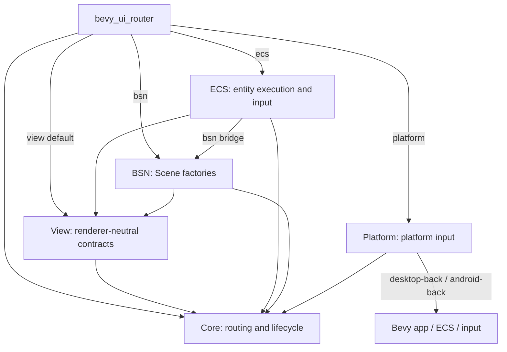
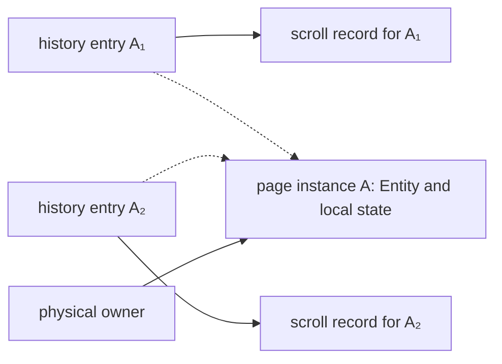

# Architecture

[中文](README.md) | [English](README.en.md)

Bevy UI Router separates choosing what to show from applying that choice to the World. Core decides routes, history, and lifecycle; ECS creates, switches, and cleans up entities. Applications use the facade. See the [overview](../overview.en.md) for capabilities and the [contracts](../contracts/README.en.md) for behavior.

## Crates and dependencies

Arrows show Cargo dependencies. Feature labels mark optional connections.

| Crate | Responsibility |
| --- | --- |
| Core | Locations, matching, branch differences, request ordering, frame/generation, history, instance retention, and recovery decisions; no external dependencies |
| View | View/driver keys, registry, descriptors, and read-only effects/inputs; depends only on Core |
| ECS | Host/slot/frame bindings, Scene execution, publication preparation, cleanup, retained content, scrolling, input, and activity queries |
| BSN | Factories that produce fresh Scenes, build errors, and default outlet declarations |
| Platform | Neutral Back types and optional mouse or traditional Android Back input conversion |
| Facade | Common APIs and feature combinations, usually imported with `bevy_ui_router::prelude::*` |

The default `view` feature keeps the dependency graph Bevy-free. `ecs` includes `view`, and `bsn` includes `ecs`. BSN's `AppBsnExt` is implemented in the ECS bridge and re-exported by the facade. BSN is the current application renderer.

`platform` is independent and also Bevy-free. `desktop-back` / `android-back` include `platform` and enable the required Bevy mouse / keyboard input. Applications select Router ECS/BSN, the window backend, and their Back handler separately. `devtools` is currently an empty feature.

## Visits, instances, and ownership

These concepts answer three different questions: which visit to return to, which page to reuse, and who manages its entities.

Core manages history and retention decisions. ECS stores scroll positions by entry key and holds entity content. Different visits can reuse one instance while keeping separate scroll records.

An owner is the unique capability responsible for physical content. It moves between active, retained, and cleanup holders. Once a request completes, an independent long-lived owner manages any retained instance. The full lifecycle also includes pending content, cleanup work, and isolated residuals; the active branch describes only the current presentation. See [navigation](../contracts/navigation.en.md) and [lifecycle](../contracts/lifecycle.en.md#inactive-instances-and-long-lived-owners).

## State and source map

These dimensions are observed separately and together describe a Router's state.

| Dimension | Public values | Meaning |
| --- | --- | --- |
| Availability | `AwaitingHost`, `Ready`, `RecoveringAuthority`, `Unavailable` | Host binding and ability to run navigation; Ready may have no page yet |
| Presentation | `None`, `Route`, `Error` | The current page or error page |
| Request | `Queued`, `Running(phase)`, `Succeeded`, `Failed` | Command progress; cleanup can continue after a visible switch |
| Cleanup | `CleanupSummary` | Pending foreground work, isolated counts, and the latest disposition |

| Area | Source |
| --- | --- |
| Route tree, matching, branch differences | [route_tree.rs](../../crates/bevy_ui_router_core/src/route_tree.rs), [matcher.rs](../../crates/bevy_ui_router_core/src/matcher.rs), [branch_diff.rs](../../crates/bevy_ui_router_core/src/branch_diff.rs) |
| Core decisions and cross-crate handoff | [engine.rs](../../crates/bevy_ui_router_core/src/engine.rs), [integration.rs](../../crates/bevy_ui_router_core/src/integration.rs), [history_authority.rs](../../crates/bevy_ui_router_core/src/history_authority.rs) |
| Retained instances | Core [retained.rs](../../crates/bevy_ui_router_core/src/engine/retained.rs); ECS [retained.rs](../../crates/bevy_ui_router_ecs/src/retained.rs) and [instance.rs](../../crates/bevy_ui_router_ecs/src/instance.rs) |
| View registry and effects | [registry.rs](../../crates/bevy_ui_router_view/src/registry.rs), [effect.rs](../../crates/bevy_ui_router_view/src/effect.rs) |
| Registration, scheduling, navigation, snapshots | [app_ext.rs](../../crates/bevy_ui_router_ecs/src/app_ext.rs), [plugin.rs](../../crates/bevy_ui_router_ecs/src/plugin.rs), [navigation.rs](../../crates/bevy_ui_router_ecs/src/navigation.rs), [snapshots.rs](../../crates/bevy_ui_router_ecs/src/snapshots.rs) |
| Hosts, mounting, Scenes | [host.rs](../../crates/bevy_ui_router_ecs/src/host.rs), [mount.rs](../../crates/bevy_ui_router_ecs/src/mount.rs), [BSN contract](../../crates/bevy_ui_router_bsn/src/lib.rs), [ECS bridge](../../crates/bevy_ui_router_ecs/src/bsn.rs) |
| Publication, failure, cleanup | [Lifecycle execution protocol](lifecycle.en.md#module-map) |
| Scrolling and current page information | [scroll.rs](../../crates/bevy_ui_router_ecs/src/scroll.rs), [activity.rs](../../crates/bevy_ui_router_ecs/src/activity.rs), [route_inputs.rs](../../crates/bevy_ui_router_ecs/src/route_inputs.rs) |
| Input and focus | [input.rs](../../crates/bevy_ui_router_ecs/src/input.rs), [native_focus.rs](../../crates/bevy_ui_router_ecs/src/native_focus.rs) |
| Window Back input | [back_input.rs](../../crates/bevy_ui_router_platform/src/back_input.rs); the application handler navigates through public `RouterNavigation::back` |

The matcher recursively walks an immutable route tree and compares candidates. See [runtime behavior](runtime.en.md) for entity structure and system ordering, and the [development guide](../development/README.en.md) for tests by feature.
