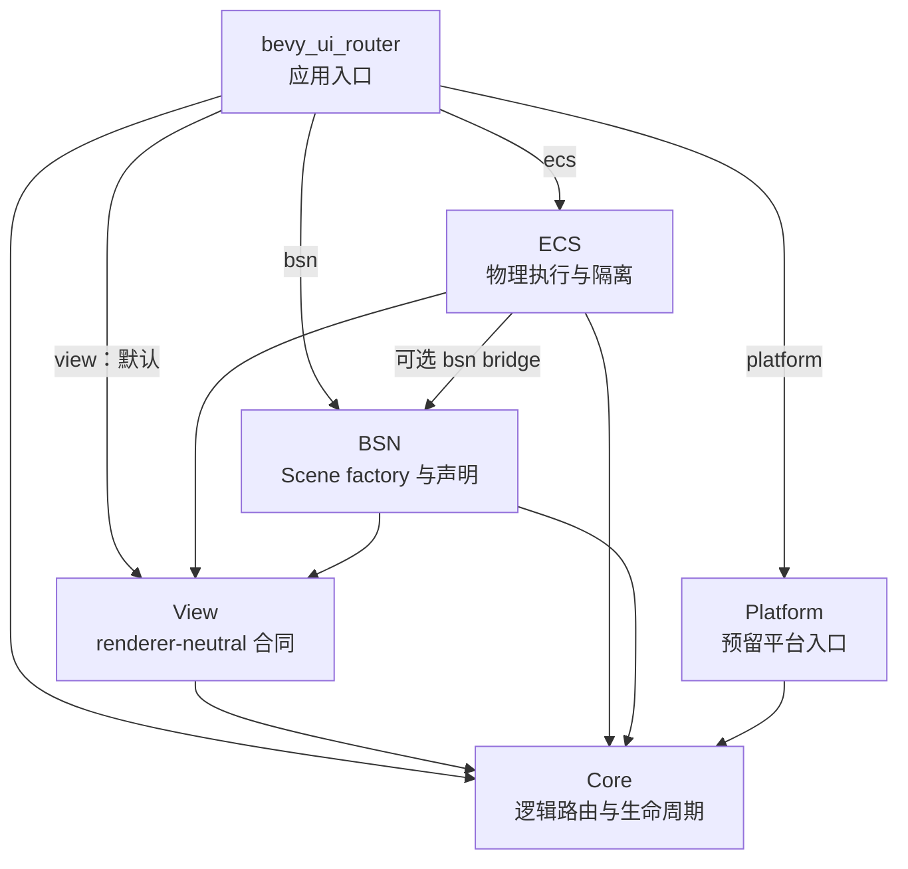
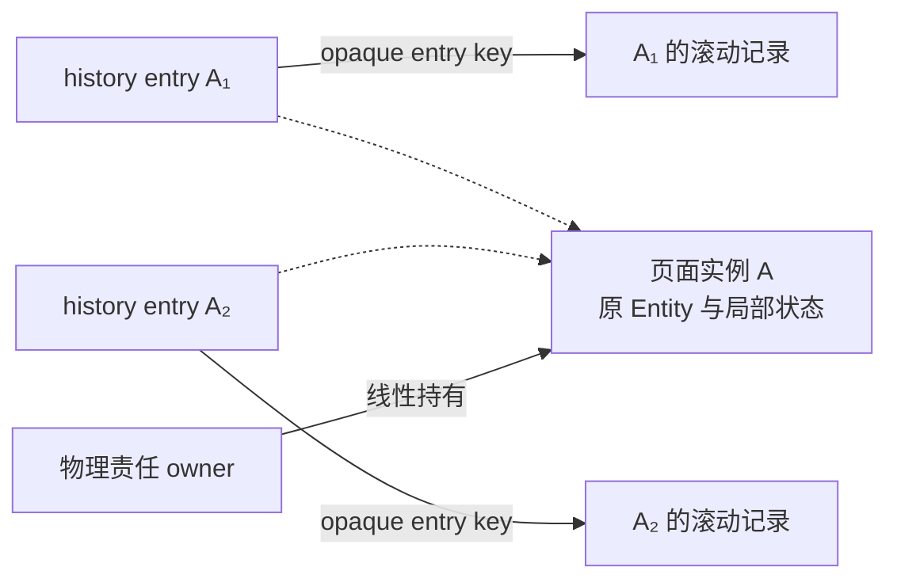

# 架构总览

本文说明当前模块边界与源码组织。先了解[产品目标](../overview.md)，再按[专题合同](../contracts/README.md)核对行为；实体结构、导航时序和 Bevy 调度见[运行机制](runtime.md)，跨层 action/owner 与失败分流见[生命周期执行协议](lifecycle.md)。

## Crate 与依赖

下图箭头表示 Cargo 依赖方向；带 feature 的边仅在相应功能开启时存在。

| Crate | 拥有的职责 | 边界 |
| --- | --- | --- |
| Core | location、匹配、branch diff、请求顺序、frame/generation、history、实例选择/保留/LRU 与父依赖、失败与恢复决策 | 无 Bevy 或其他外部依赖，不操作 Entity |
| View | view key、driver key、registry、descriptor、只读 effect/input | 仅依赖 Core，不拥有 World 或 lifecycle 权限 |
| ECS | host/slot/frame binding、执行编排、staging、publication、cleanup、retained 物理内容、滚动、输入与活动资格 | 消费 Core 的受控合同，不维护第二套路由/history |
| BSN | fresh Scene factory、build error、default outlet 声明 | 不依赖 ECS，不签发 mount、frame 或 commit 权限 |
| Platform | 当前仅转导出 Back 相关类型 | 尚无浏览器 history、URL 同步或系统 Back 实现 |
| Facade | 常用 API 与 opt-in feature 组合 | 不导出内部 owner、registry writer 或可伪造的完成凭据 |

`default = ["view"]` 不引入 Bevy。`ecs` 包含 `view`，`bsn` 包含 `ecs`；
`platform` 独立开启，`devtools` 当前为空 feature。
BSN 的 `AppBsnExt` 实现在 ECS 的可选 bridge 中，再由 facade 导出。
这样 Scene 声明层无需反向依赖完整 ECS runtime。

应用通常使用 `bevy_ui_router::prelude::*`。Core/View 的独立 crate 可用于
纯路由模型与 renderer-neutral 合同；当前可注册的生产 renderer 是 BSN。
私有 Data executor 用于独立验证同一 Core/ECS 管线，不是外部 renderer 插件 API。

## 访问、实例与责任

这三个维度分别回答“回到哪次访问”“复用哪个页面”和“谁负责物理内容”。图中虚线表示不同时刻可能复用同一实例，不是 history 保存 Entity 或持有缓存的关系。

Core 拥有 history 与保留决策，ECS 按 opaque entry key 保存滚动位置，并持有原物理 payload。owner 随 active、retained 与 cleanup 的受控交接移动；页面仍存活，不意味着原请求还应持有前台 capability。active branch 只描述当前呈现，完整生命周期库存还包括 retained、pending、cleanup 和私有残留责任。精确行为归[导航](../contracts/navigation.md)与[生命周期](../contracts/lifecycle.md#非活动实例与长期-owner)。

## 状态与源码入口

下列状态属于不同维度，不能合并为一个全局线性状态机。

| 维度 | 公开观察 | 含义 |
| --- | --- | --- |
| Router availability | `AwaitingHost`、`Ready`、`RecoveringAuthority`、`Unavailable` | 当前是否能接纳并运行导航；Ready 可以尚无 active |
| Active presentation | `None`、`Route`、`Error` | 当前可见呈现；Error 不会把原失败请求改成成功 |
| Request | `Queued`、`Running(phase)`、`Succeeded`、`Failed` | 单次命令进度，终态可能晚于可见切换 |
| Cleanup | `CleanupSummary` | 前台 pending、隔离计数和最后 disposition，与当前 active 分开观察 |

| 需要定位的实现 | 入口 |
| --- | --- |
| route tree、稳定候选匹配、prefix/suffix | [route_tree.rs](../../crates/bevy_ui_router_core/src/route_tree.rs)、[matcher.rs](../../crates/bevy_ui_router_core/src/matcher.rs)、[branch_diff.rs](../../crates/bevy_ui_router_core/src/branch_diff.rs) |
| Core 决策与跨 crate 协议 | [engine.rs](../../crates/bevy_ui_router_core/src/engine.rs)、[integration.rs](../../crates/bevy_ui_router_core/src/integration.rs) |
| history authority、post-commit 与 idle settlement | [history_authority.rs](../../crates/bevy_ui_router_core/src/history_authority.rs)、[post_commit.rs](../../crates/bevy_ui_router_core/src/engine/post_commit.rs)、[idle_host_loss.rs](../../crates/bevy_ui_router_core/src/engine/idle_host_loss.rs) |
| 实例保留、父依赖/LRU 与自身失效 continuation | Core [retained.rs](../../crates/bevy_ui_router_core/src/engine/retained.rs)，ECS [retained.rs](../../crates/bevy_ui_router_ecs/src/retained.rs)、[retained_miss.rs](../../crates/bevy_ui_router_ecs/src/navigation/retained_miss.rs) |
| 单实例物理 payload 与预分配转移接收器 | ECS [instance.rs](../../crates/bevy_ui_router_ecs/src/instance.rs)；只读 payload 投影不持有 owner |
| entry 滚动与页面活动资格 | ECS [scroll.rs](../../crates/bevy_ui_router_ecs/src/scroll.rs)、[activity.rs](../../crates/bevy_ui_router_ecs/src/activity.rs) |
| View registry 与 effect | [registry.rs](../../crates/bevy_ui_router_view/src/registry.rs)、[effect.rs](../../crates/bevy_ui_router_view/src/effect.rs) |
| 注册、调度、导航、快照 | [app_ext.rs](../../crates/bevy_ui_router_ecs/src/app_ext.rs)、[plugin.rs](../../crates/bevy_ui_router_ecs/src/plugin.rs)、[navigation.rs](../../crates/bevy_ui_router_ecs/src/navigation.rs)、[snapshots.rs](../../crates/bevy_ui_router_ecs/src/snapshots.rs) |
| host、slot、frame 与内容执行 | [host.rs](../../crates/bevy_ui_router_ecs/src/host.rs)、[mount.rs](../../crates/bevy_ui_router_ecs/src/mount.rs)、[presentation.rs](../../crates/bevy_ui_router_ecs/src/presentation.rs)、[native_scene.rs](../../crates/bevy_ui_router_ecs/src/presentation/native_scene.rs) |
| ownership 与清理 | [registry.rs](../../crates/bevy_ui_router_ecs/src/registry.rs)、[cleanup.rs](../../crates/bevy_ui_router_ecs/src/cleanup.rs)、[cleanup/](../../crates/bevy_ui_router_ecs/src/cleanup) |
| publication 准备 | [normal_publication.rs](../../crates/bevy_ui_router_ecs/src/navigation/normal_publication.rs)、[projectionless_publication.rs](../../crates/bevy_ui_router_ecs/src/navigation/projectionless_publication.rs)、[branch_transaction.rs](../../crates/bevy_ui_router_ecs/src/branch_transaction.rs) |
| reconciliation、frame-local、native failure 与 authority settlement | [生命周期执行协议的模块地图](lifecycle.md#修改时定位哪些模块) |
| 输入与焦点 | [input.rs](../../crates/bevy_ui_router_ecs/src/input.rs)、[native_focus.rs](../../crates/bevy_ui_router_ecs/src/native_focus.rs) |
| BSN 合同与 bridge | [BSN lib.rs](../../crates/bevy_ui_router_bsn/src/lib.rs)、[ECS bsn.rs](../../crates/bevy_ui_router_ecs/src/bsn.rs) |

matcher 当前递归遍历不可变路由树并比较候选，不是 trie。
架构保持 renderer-neutral 边界，但不预建第二种 renderer、平台路由 runtime 或
通用插件框架；扩展是否值得做由实际需求与验证证据决定。
