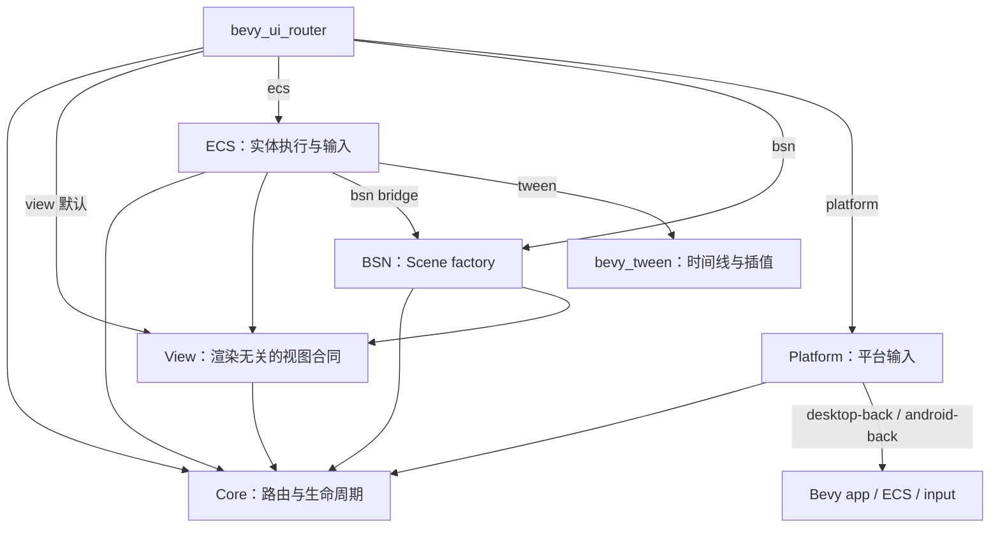
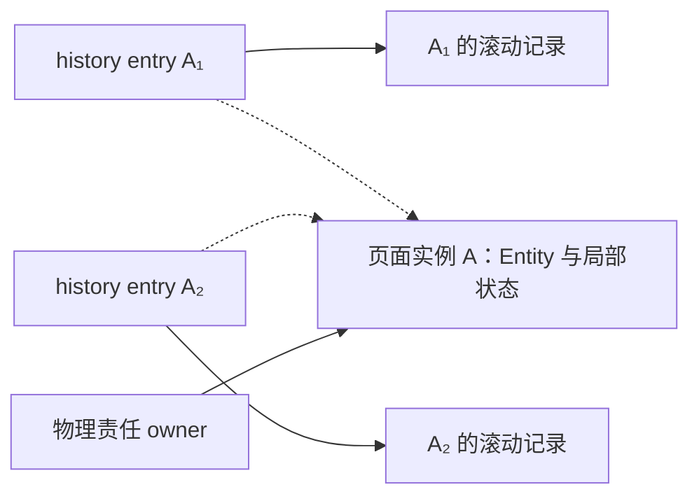

# 架构总览

[中文](README.zh-CN.md) | [English](README.md)

Bevy UI Router 将“决定显示什么”和“在 World 中执行切换”分开。Core 决定路由、访问记录和生命周期，ECS 执行实体创建、切换与清理。应用通过 facade 接入。产品能力见[概览](../overview.zh-CN.md)，行为规则见[专题合同](../contracts/README.zh-CN.md)。

## Crate 与依赖

箭头表示 Cargo 依赖方向，标注 feature 的连接按需启用。

| Crate | 职责 |
| --- | --- |
| Core | location、匹配、分支差异、请求顺序、frame/generation、history、实例保留和恢复决策；无外部依赖 |
| View | view/driver key、registry、descriptor 和只读 effect/input；仅依赖 Core |
| ECS | host/slot/frame 绑定、Scene 执行、发布准备、清理、保留内容、滚动、输入和活动查询 |
| BSN | 生成新 Scene 的 factory、构建错误和 default outlet 声明 |
| Platform | 中立 Back 类型，以及可选的鼠标和 Android 传统 Back 消息转换 |
| Facade | 常用 API 和 feature 组合，通常通过 `bevy_ui_router::prelude::*` 使用 |

默认 `view` feature 保持纯 Rust 依赖。`ecs` 包含 `view`，`bsn` 包含 `ecs`；BSN 的 `AppBsnExt` 在 ECS bridge 实现，再由 facade 导出。当前应用使用 BSN renderer。

`BsnRouter` 声明在 ECS 的 BSN 接入模块中编译为现有 Core 路由树、View registry 和 factory bindings；应用不必逐项组装它们。Commands 导航与一次性 initial 都通过原 `RouterNavigation` 入队。当前输入查询保持只读，可与应用 Query 和 Commands 共存。

`tween` 包含 `ecs`，按需接入 `bevy_tween`。适配模块管理动画控制器与原过渡 session 的时机，应用提供具体效果；Core、默认 feature 和普通 `bsn` 接入不依赖动画库。

`platform` 独立开启，保持纯 Rust 依赖。`desktop-back` / `android-back` 包含 `platform`，分别启用需要的 Bevy mouse / keyboard 输入。应用自行选择 Router ECS/BSN、窗口后端和返回处理器。`devtools` 当前是空 feature。

## 访问、实例与责任

三个概念分别回答“回到哪次访问”“复用哪个页面”和“谁管理实体”。

Core 管理 history 和保留决策，ECS 按 entry key 保存滚动位置并持有实体内容。不同访问可以复用同一实例，仍各有自己的滚动记录。

owner 是负责某段物理内容的唯一凭据，随 active、retained 和 cleanup 交接移动。请求完成后，保留实例由独立长期 owner 管理。完整生命周期还包含 pending、待清理内容和已隔离残留；active branch 只描述当前呈现。详细规则见[导航](../contracts/navigation.zh-CN.md)和[生命周期](../contracts/lifecycle.zh-CN.md#非活动实例与长期-owner)。

## 状态与源码入口

以下状态分别观察，组合起来描述 Router 的现状。

| 维度 | 公开值 | 含义 |
| --- | --- | --- |
| 可用性 | `AwaitingHost`、`Ready`、`RecoveringAuthority`、`Unavailable` | 是否已绑定 host、能否执行导航；Ready 时也可能尚无页面 |
| 当前呈现 | `None`、`Route`、`Error` | 当前页面或错误页面 |
| 请求 | `Queued`、`Running(phase)`、`Succeeded`、`Failed` | 单次命令进度；页面切换后可能仍在清理 |
| 清理 | `CleanupSummary` | 前台待处理责任、隔离数量和最近处置结果 |

| 功能 | 源码入口 |
| --- | --- |
| 路由树、匹配、分支差异 | [route_tree.rs](../../crates/bevy_ui_router_core/src/route_tree.rs)、[matcher.rs](../../crates/bevy_ui_router_core/src/matcher.rs)、[branch_diff.rs](../../crates/bevy_ui_router_core/src/branch_diff.rs) |
| Core 决策与跨 crate 交接 | [engine.rs](../../crates/bevy_ui_router_core/src/engine.rs)、[integration.rs](../../crates/bevy_ui_router_core/src/integration.rs)、[history_authority.rs](../../crates/bevy_ui_router_core/src/history_authority.rs) |
| 实例保留 | Core [retained.rs](../../crates/bevy_ui_router_core/src/engine/retained.rs)，ECS [retained.rs](../../crates/bevy_ui_router_ecs/src/retained.rs) 与 [instance.rs](../../crates/bevy_ui_router_ecs/src/instance.rs) |
| View registry 与 effect | [registry.rs](../../crates/bevy_ui_router_view/src/registry.rs)、[effect.rs](../../crates/bevy_ui_router_view/src/effect.rs) |
| 公开声明与便捷导航 | [BSN declaration](../../crates/bevy_ui_router_ecs/src/bsn/declaration.rs)、[install](../../crates/bevy_ui_router_ecs/src/bsn/install.rs)、[navigation commands](../../crates/bevy_ui_router_ecs/src/navigation_commands.rs) |
| 注册、调度、导航、快照 | [app_ext.rs](../../crates/bevy_ui_router_ecs/src/app_ext.rs)、[plugin.rs](../../crates/bevy_ui_router_ecs/src/plugin.rs)、[navigation.rs](../../crates/bevy_ui_router_ecs/src/navigation.rs)、[snapshots.rs](../../crates/bevy_ui_router_ecs/src/snapshots.rs) |
| host、挂载与 Scene | [host.rs](../../crates/bevy_ui_router_ecs/src/host.rs)、[mount.rs](../../crates/bevy_ui_router_ecs/src/mount.rs)、[BSN 合同](../../crates/bevy_ui_router_bsn/src/lib.rs)、[ECS bridge](../../crates/bevy_ui_router_ecs/src/bsn.rs) |
| 发布、失败和清理 | [生命周期执行协议](lifecycle.zh-CN.md#修改时定位哪些模块) |
| 滚动与当前页面信息 | [scroll.rs](../../crates/bevy_ui_router_ecs/src/scroll.rs)、[activity.rs](../../crates/bevy_ui_router_ecs/src/activity.rs)、[route_inputs.rs](../../crates/bevy_ui_router_ecs/src/route_inputs.rs) |
| 输入与焦点 | [input.rs](../../crates/bevy_ui_router_ecs/src/input.rs)、[native_focus.rs](../../crates/bevy_ui_router_ecs/src/native_focus.rs) |
| 窗口返回 | [back_input.rs](../../crates/bevy_ui_router_platform/src/back_input.rs)；应用处理器通过公开 `RouterNavigation::back` 导航 |

matcher 递归遍历不可变路由树并比较候选。实体结构、导航过程和系统顺序见[运行机制](runtime.zh-CN.md)；修改功能时从[开发指南](../development/README.zh-CN.md)选择对应测试。
