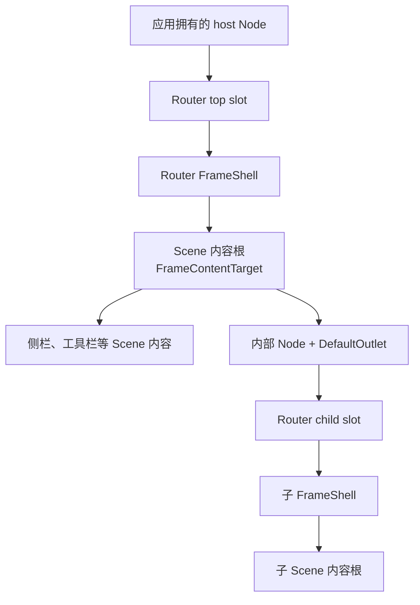
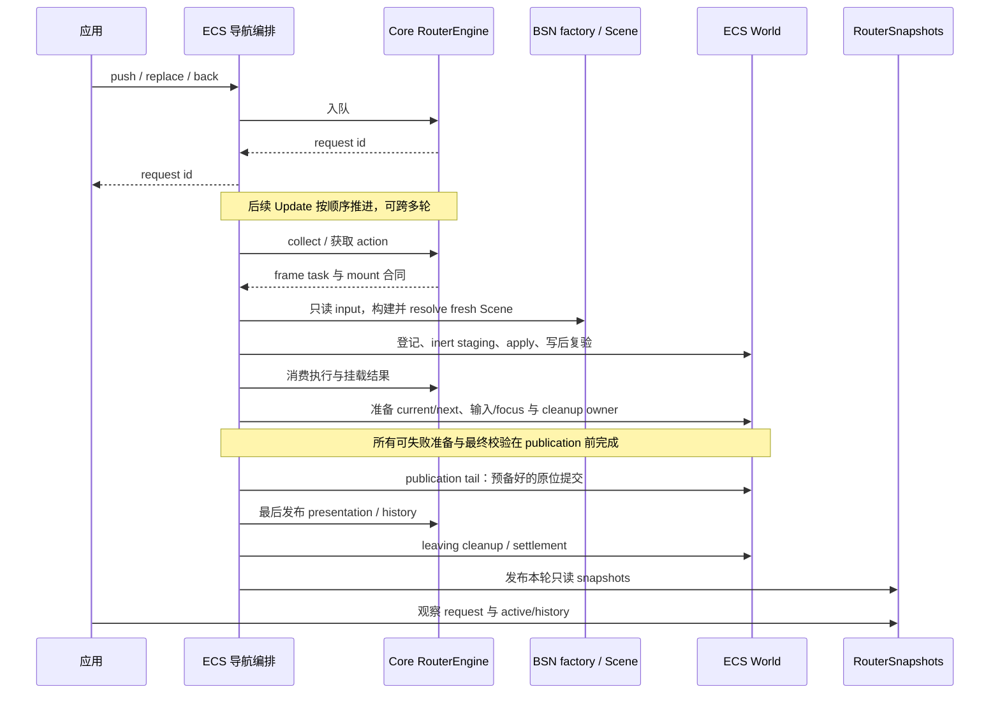
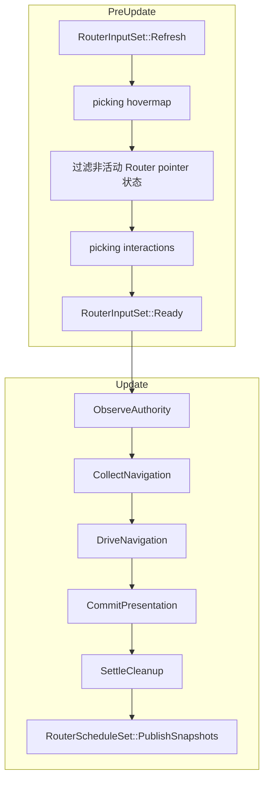

# 运行机制

本文沿实际执行路径解释 frame 结构、导航时序与调度。模块及源码地图见[架构总览](README.md)，内部 action/owner 交接及失败分流见[生命周期执行协议](lifecycle.md)，身份与结算合同见[生命周期](../contracts/lifecycle.md)，输入行为见[输入与焦点](../contracts/input-focus.md)。

## 逻辑模型与物理结构

Core 的匹配结果是一条有序分支。`BranchDiff` 保留可复用的 common prefix，
按从叶到根的顺序离场旧 suffix，按从根到叶的顺序准备新 suffix。
ECS 将每个逻辑 frame 绑定到实际 host、slot 与内容边界。

host 由应用创建、布置并添加 `RouterHostRegistration`。Router 管理自己的
top slot、frame shell、child slot 及授权内容边界，不删除或重建 host。
`DefaultOutlet` 是 Scene 内的普通声明，可以放在内部容器上；它本身不是
mount binding 或 lifecycle owner。

结构身份关联 Router、host、slot、frame 与 generation；执行结果还需匹配 task。
host registration 的 incarnation 区分同一 Entity 上移除再插入的实例。
数值相同、查询位置相同或同一 tick 均不能代替 exact identity。

Router 自建结构与 Scene 创建期 allocation 先登记 ownership，再写入可能触发
hook/observer 的 component 或关系，并在写后复验。成功 adoption 后，普通
Scene 后代按当前 `ChildOf/Children` containment 管理，不保留整棵内容树的永久
`FrameOutput` marker 清单。

因此，应用可以更新受管 Scene 的正常组件和动态子内容；不应把借用的 app-owned
Entity 挂进 Router 内容边界。普通内容移出该边界后由应用承担后续管理责任。
Router 自有结构的 owner 不会因意外脱离关系树而消失。

## 正常导航时序

应用入队得到 request id；后续 `Update` 推进匹配、逐层准备和提交。
入队成功不表示页面已发布，也不保证一次 update 就完成整条分支。

factory 每次产生一个 fresh Scene，错误呈现也使用自己的 Scene；不克隆或回放
旧执行产物。ECS 通过官方 `ScenePatch::load/resolve` 准备，再由实际 Scene executor
执行模板。依赖 handles 随该次 preparation/apply/settlement 保留。

ECS 先将物理切换、输入/focus 和后续 cleanup owner 组合成准备好的 publication work，
再由预借状态的提交 tail 应用，最后交给 Core 发布 presentation/history。
具体不可失败边界由[publication 合同](../contracts/lifecycle.md#ownership-与-publication)定义；
内部交接见[生命周期执行协议](lifecycle.md)。

旧内容的物理清理可以晚于可见 publication，请求也可能仍处于 `PostCommitCleanup`。
这时已发布页面和 history 已生效；清理失败不能回滚或改写原成功结果。
snapshot 发布是每轮观察出口，与真正的 presentation publication 是不同步骤。

失败路径复用相同 Core 决策和 ECS ownership 边界：先处理该次失败的物理义务，
再推进明确的 error boundary、fallback 或 authority settlement。
cleanup target 与 protected closure 分开冻结，写后重新确认；无法安全删除的残留
由私有隔离责任持有，不继续占用终态请求的前台 lifecycle capability。
当前没有后台 reaper 自动回收这些残留。

## Bevy 调度与输入

`Update` 的前五个生命周期 set 是 crate-private；公开的本轮观察排序锚点只有
`RouterScheduleSet::PublishSnapshots`。普通应用系统在它之后读取 snapshots，
可观察本轮完整结果。显式 plugin 与 App extensions 共用幂等 foundations 安装。

`Refresh` 在 picking hover 前更新当前内容资格；hovermap 生成后、interaction 更新前
过滤非活动目标。正常 publication 同次调用撤销离场目标的历史 hover、press、click、
drag 与 focus，避免旧手势在下一轮继续命中。

应用的目标定向 keyboard/gamepad handler 在 `RouterInputSet::Ready` 之后读取
`RouterInputGate`。它们仍由应用编写；安装 Router 不会自动让所有原生焦点导航或
输入分发插件遵守 gate。具体接入见[集成指南](../guides/integration.md)。
