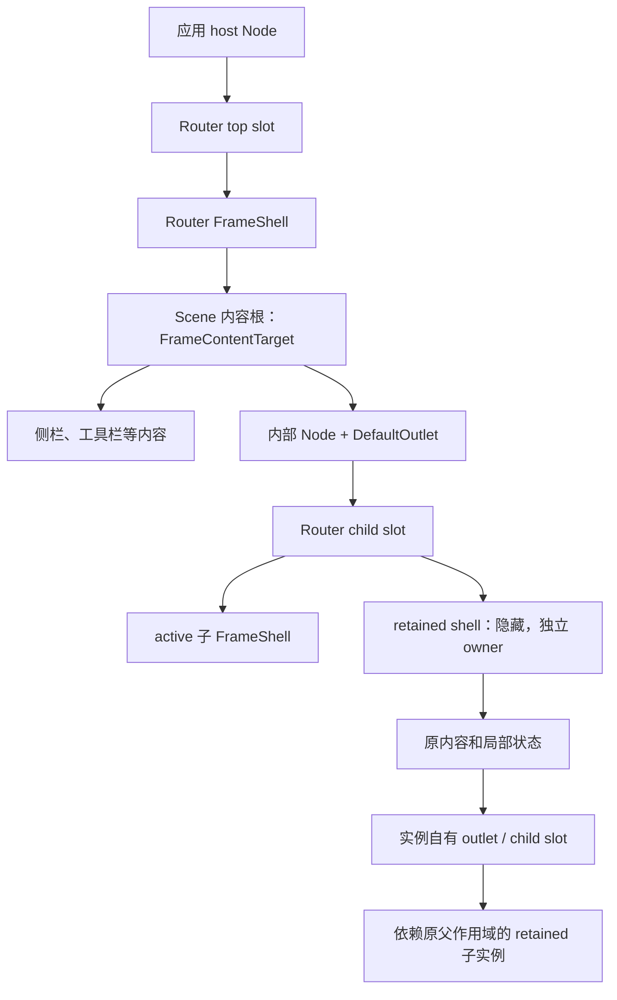
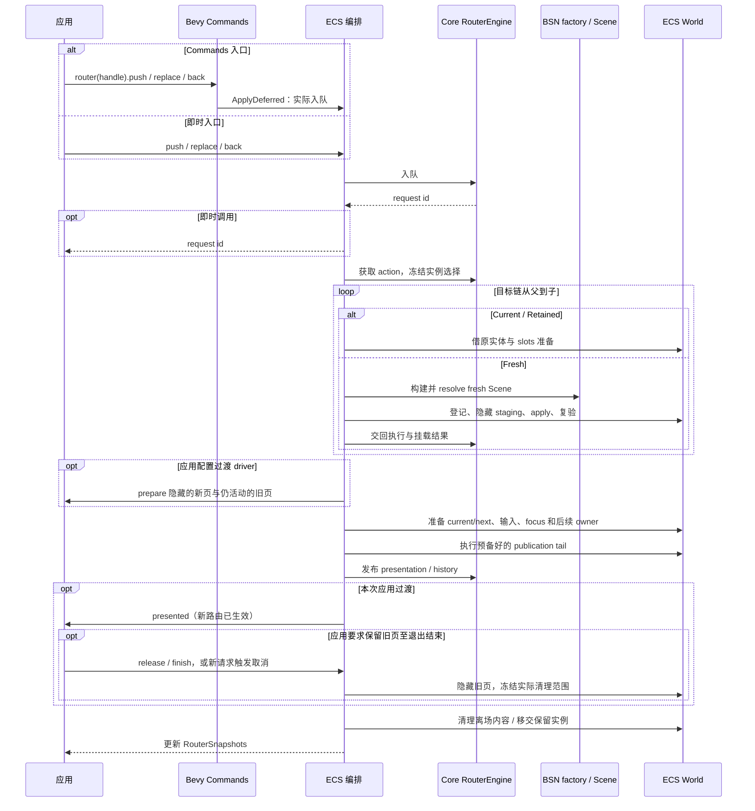
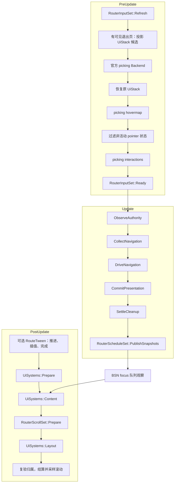

# 运行机制

[中文](runtime.md) | [English](runtime.en.md)

本页沿一次导航解释实体结构、执行顺序和 Bevy 调度。模块地图见[架构总览](README.md)，内部责任交接见[生命周期执行协议](lifecycle.md)。

## 逻辑模型与物理结构

Core 的匹配结果是一条有序分支。`BranchDiff` 保留可复用的公共前缀，从叶到根退出旧后缀，再从根到叶准备新后缀。ECS 将每个逻辑 frame 绑定到实际 host、slot 和内容边界。

应用创建、布置 host 并添加 `RouterHostRegistration`。Router 管理 top slot、frame shell、child slot 和授权内容。host、其样式及其他应用子节点继续由应用管理。

`DefaultOutlet` 是 Scene 中的普通声明，放在内容根或内部容器上。ECS 验证后建立实际 mount binding。保留实例和当前实例可共享原 child slot，各自有独立 role、claim 和 owner；父 frame 的内容遍历在 child slot 处停止。

结构身份关联 Router、host、slot、frame 和 generation；执行结果还匹配 task。host registration 的 incarnation 区分同一 Entity 上的每次注册，包括同一 tick 内移除再插入。

Router 自建结构和 Scene 创建期实体先登记 ownership，再写 component 或 relationship，随后复验。成功 adoption 后，普通 Scene 后代按当前 `ChildOf/Children` 归属管理。应用可以更新普通组件和动态子内容；挂入这段内容边界的实体随该页面管理，移出的普通内容交回应用。Router 自建结构仍由原 owner 负责。

## 正常导航时序

即时导航入队返回 request id；Commands 入口在 Bevy 应用延迟命令时才实际入队，不同步返回 ID。后续 `Update` 按顺序推进，可跨多轮完成。配置的 initial 在首次 Ready 后进入同一队列；成功显式导航取消尚未入队的默认位置。

fresh 路径通过官方 `ScenePatch::load/resolve` 和 Scene executor 应用新 Scene。缓存命中复用原 frame、内容 handles 和实体，跳过 factory、resolve 和 apply；本次请求仍有自己的执行身份。

混合分支按 `Current* → Retained* → Fresh*` 准备。Core 决定选择、容量和淘汰，ECS 持有每个实例的原内容及其自有 slots。fresh 子使用本次选中的父挂载；新 slot 在发布前属于 preparation，成功后交给父实例，失败时清理。父依赖淘汰按 child-first 顺序执行。

发布准备完成物理切换、claim rebind、输入/focus 和后续 owner 的组合。tail 只应用已准备状态，Core 最后发布 presentation/history。具体规则见[publication 合同](../contracts/lifecycle.md#ownership-与-publication)。旧内容清理可以随后进行，此时请求可能仍为 `PostCommitCleanup`，新页面和 history 已生效。

可选过渡把应用展示会话与物理退出 owner 分开。应用先写初始样式，发布后才推进自己的动画；只做进入动画不延后请求终态。需要退出存续时，旧页可见但已非 active，原清理责任延至 release；动态内容此时才按真实 containment 冻结。具体接入见[过渡指南](../guides/transitions.md)。

滚动记录归 ECS [scroll.rs](../../crates/bevy_ui_router_ecs/src/scroll.rs) 管理。Core 提供 entry 与目标 frame/reuse 事实；准备阶段冻结恢复意图，tail 安装意图。早已存在和后来出现的容器都在正常布局前写入恢复位置，布局后结算一次。等待期间分别保存恢复目标与实际显示位置，离场时复验绑定和应用的新值。详见[按访问恢复滚动](../contracts/navigation.md#按访问恢复滚动)。

失败先结算本次物理责任，再进入 error boundary、fallback 或 authority settlement。清理分别验证 target 与 protected 内容，写后重新检查。无法安全删除的内容转入明确的残留责任；Router shell 和输入 gate 负责隔离，Scene 原有 `Node`、`Visibility`、`Pickable` 保持其定义值。

## Bevy 调度与输入

应用使用以下公开排序点：

- 在 `RouterInputSet::Refresh` 前提交动态拓扑修改；在 `Ready` 后读取 `RouterInputGate` 并处理目标定向 keyboard/gamepad 输入。
- 在 `RouterScheduleSet::PublishSnapshots` 后读取本轮 snapshots、`RouteInputs` 和 `RouteActivity`。此时本轮布局和滚动结算尚在后续 `PostUpdate` 执行。
- `RouterScrollSet::Prepare` 位于 `UiSystems::Content` 后、`UiSystems::Layout` 前，写入本轮恢复请求。

图中其余生命周期 set 为 crate-private，由 ECS 编排。插件和 App extensions 共用幂等安装逻辑。

可选 `RouteTweenPlugin` 在 UI Prepare 前使用独立时间上下文推进 `bevy_tween` 控制器，从 presented 时刻开始计时。官方插值写完最后一帧后移除对应控制器，再通知原过渡释放或完成；取消同步移除写入者。应用可同时使用自己的 Tween 插件。页面系统在 PublishSnapshots 后提交的导航可能在后续更新发布，不能把 Commands 调用视为同步页面切换。

输入在 picking Backend 前刷新资格；有可见退出页时暂时排除其原生 UI 候选，Backend 后恢复完整栈，避免旧页阻挡新页命中。随后在 hover 生成后、interaction 前过滤非活动目标。publication 同次调用撤销离场目标的历史 hover、press、click、drag 和 focus。原生 TabNavigation/InputDispatch 的目标过滤由应用接入，具体步骤见[接入指南](../guides/integration.md)。

只读阶段可复用本轮 frame 内容、membership 和 child-slot 切口，写入后或进入新调度阶段重新观察。focus 还验证 shell、已提交切口和 slot 外侧闭包；保留实例验证完整后代及其与输入/focus 的隔离。

空工作阶段直接返回，空闲 host 仍每轮观察。滚动 Prepare 在无意图时返回，Settle 继续采样实际布局；所有 `RouteScroll` marker 先参与 key 判重，再筛选布局资格。snapshots 仅在值变化时标记 changed，输入 gate 仅在权限变化或需要撤权时写入。BSN focus 桥在首次使用或 `PostUpdate` 调度图变化后核查官方 drain，稳定调度继续观察焦点队列。
