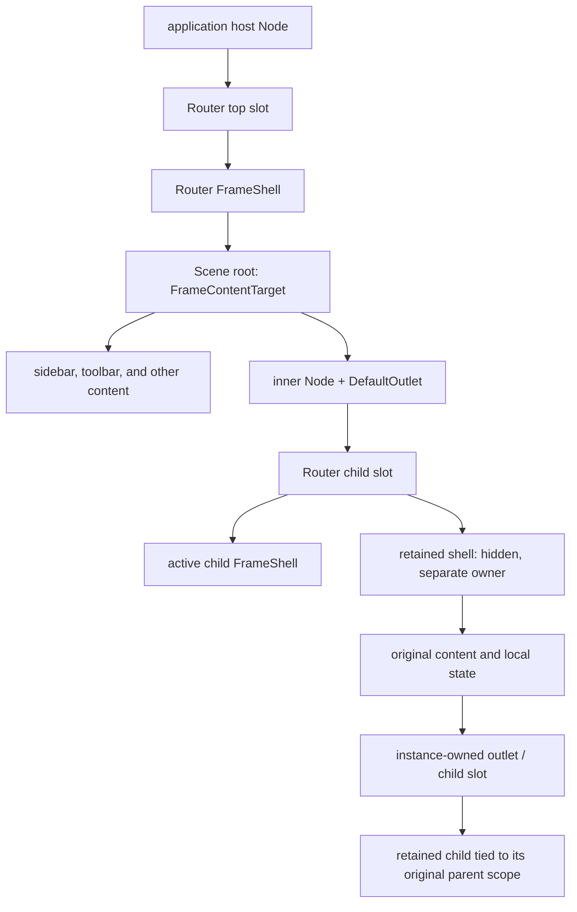
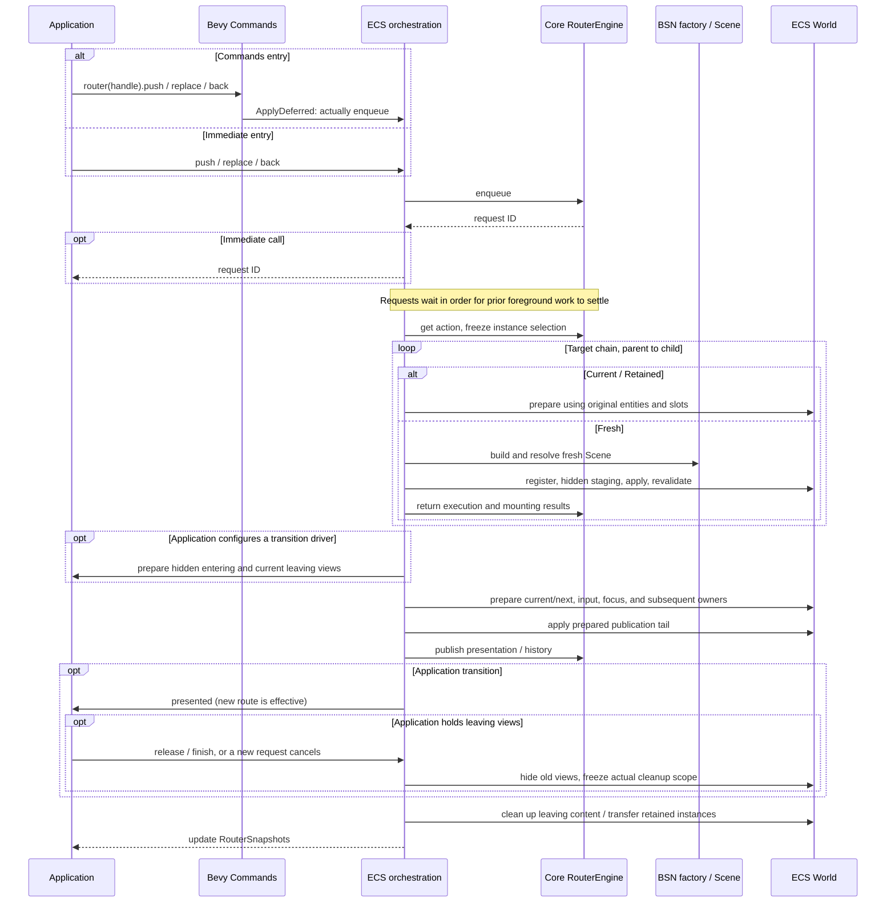
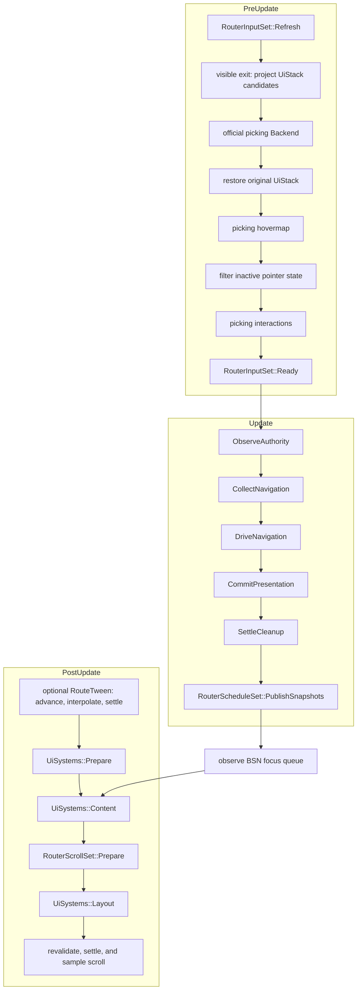
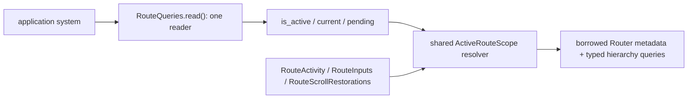

# Runtime behavior

[中文](runtime.zh-CN.md) | [English](runtime.md)

This page follows a navigation through entity structure, execution, and Bevy scheduling. See the [architecture](README.md) for modules and the [lifecycle execution protocol](lifecycle.md) for internal ownership handoffs.

## Logical model and entity structure

Core produces an ordered matched branch. `BranchDiff` preserves its reusable common prefix, leaves the old suffix from leaf to root, then prepares the new suffix from root to leaf. ECS binds each logical frame to a host, slot, and content boundary.

The application creates and styles the host and adds `RouterHostRegistration`. Router manages the top slot, frame shells, child slots, and authorized content. The application keeps control of the host, its style, and its other children.

`DefaultOutlet` is an ordinary Scene declaration on the content root or an inner container. ECS validates it and creates the actual mount binding. Retained and active instances may share the original child slot, each with its own role, claim, and owner. A parent frame's content traversal stops at child slots.

Structural identity includes Router, host, slot, frame, and generation; execution results also match the task. A host registration incarnation distinguishes each registration on the same Entity, including removal and reinsertion in one tick.

Router structures and Scene creation allocations are registered for ownership before component or relationship writes, then validated again. After successful adoption, ordinary Scene descendants are managed by current `ChildOf/Children` containment. Applications can update components and dynamic children; entities added inside this content boundary are managed with the page, and ordinary content moved out returns to application ownership. Router structures remain their original owner's responsibility.

## Normal navigation

Immediate navigation returns a request ID. Commands navigation enqueues only when Bevy applies deferred commands, without a synchronous ID. Later `Update` passes advance requests in order, possibly across several updates. A configured initial location enters the same queue after the first Ready state; successful explicit navigation consumes the unsubmitted default.

Fresh content uses official `ScenePatch::load/resolve` and the Scene executor. A cache hit reuses the original frame, content handles, and entities, skipping factory, resolve, and apply. The new request still has its own execution identity.

Mixed branches prepare as `Current* → Retained* → Fresh*`. Core decides selection, capacity, and eviction; ECS holds each instance's original content and owned slots. A fresh child uses the parent mount selected for this request. New slots belong to preparation until publication, then transfer to the parent; failure cleans them up. Parent dependency eviction runs child-first.

Publication preparation combines the physical switch, claim rebinds, input/focus changes, and subsequent owners. The tail applies prepared state, and Core publishes presentation/history last. See the [publication contract](../contracts/lifecycle.md#ownership-and-publication). Cleanup of old content may follow: the request can remain in `PostCommitCleanup` while the new page and history are already effective.

Optional transitions separate the application presentation session from physical exit ownership. The application prepares initial styles before publication and starts its own animation afterward. Enter-only animation does not delay request completion. An exit hold keeps the old page visible but inactive; release then freezes actual containment for cleanup. See the [transition guide](../guides/transitions.md).

ECS [scroll.rs](../../crates/bevy_ui_router_ecs/src/scroll.rs) manages scroll records. Core provides entry and target frame/reuse facts; preparation freezes restoration intents, and the tail installs them. Preparation copies the entry index and shares immutable per-visit position maps through `Arc`; source replacement creates a new value, and layout sampling uses copy-on-write to keep prepared and current states isolated. Existing and late containers receive their requested position before normal layout and settle once afterward. While waiting, restoration targets and displayed positions remain separate; leaving revalidates bindings and application edits. See [scroll restoration by visit](../contracts/navigation.md#scroll-restoration-by-visit).

Failure first settles its physical obligations, then follows the error boundary, fallback, or authority-settlement path. Cleanup validates target and protected content separately and checks again after writes. Content that cannot be safely deleted moves to an explicit residual owner. Router shells and the input gate provide isolation while preserving Scene-authored `Node`, `Visibility`, and `Pickable` values.

## Bevy scheduling and input

Applications use these public ordering points:

- Submit dynamic topology changes before `RouterInputSet::Refresh`; read `RouterInputGate` and handle target-addressed keyboard/gamepad input after `Ready`.
- Read this update's snapshots and `RouteQueries` after `RouterScheduleSet::PublishSnapshots`. Layout and scroll settlement still follow in `PostUpdate`.
- `RouterScrollSet::Prepare` runs after `UiSystems::Content` and before `UiSystems::Layout`, writing restoration requests for that update.

The other lifecycle sets in the diagram are crate-private and orchestrated by ECS. Plugins and App extensions share idempotent installation.

Optional `RouteTweenPlugin` advances `bevy_tween` controllers before UI Prepare using a separate time context, starting at presented. After official interpolation applies the final pose, the adapter removes the corresponding controllers and requests release or completion through the original transition session. Cancellation removes writers synchronously. Applications may also use their own Tween plugins. Navigation submitted after PublishSnapshots can publish in a later update; a Commands call is not a synchronous page switch.

Input eligibility refreshes before the picking Backend. While an exit is visible, its native UI candidates are temporarily excluded and the complete stack is restored after Backend, allowing the new page to receive hits. Inactive targets are then filtered between hover generation and interactions. Publication revokes leaving targets' historical hover, press, click, drag, and focus in the same call. Applications integrate target filtering for native TabNavigation/InputDispatch; see the [input integration](../guides/pages.md#input-and-focus).

The input gate retains an ordered permission projection. Publication prepares pure change data once, then binds it to the mutable resource receiver only if the original allowed and revoked projections still match exactly. The existing atomic tail applies the bound change; the gate is written only when permissions change or revocation is needed.

Application queries use a [public reader](../../crates/bevy_ui_router_ecs/src/route_queries.rs) borrowing current Router metadata and typed hierarchy queries. Call `RouteQueries::read()` once before a loop to share frame/mount checks, target results, and lookups alongside application queries and Commands.

Observations are scoped to the reader borrow; each new `read()` starts from current metadata and hierarchy. Completed ordinary-ancestor resolutions are shared within that borrow. Registered boundaries retain their role checks, so a direct output query cannot authorize its descendants. The three existing query entry points use the same resolver; repeated and mixed lookups share work through the reader.

Internal active-branch observation separately uses a private [ReadObservation](../../crates/bevy_ui_router_ecs/src/read_observation.rs) to share the registry index, native content membership, outlet counts, and identical retained-preservation checks within one immutable World borrow. Role-specific values, mount bindings, and manifest policies remain separate checks; preservation never authorizes activation or cleanup. Writes and new scheduling phases require a new observation. Focus also validates shells, committed boundaries, and the closure outside slots; retained instances validate all descendants and their separation from input/focus.

Snapshots use a private store keyed by Router and request identity to reuse closed, immutable traces. Diagnostics continue to update when their values change. Public snapshot values, equality, and `Changed` semantics remain value-based.

Empty work phases return immediately, while idle hosts are still observed each update. Without any `RouteScroll` markers, scroll-specific container collection is skipped; history maintenance and pending restoration intents still run. Scroll Prepare returns when no intents exist; Settle keeps sampling actual layout. All markers participate in duplicate-key detection before layout eligibility is checked. The BSN focus bridge checks the official drain on first use or after changes to the `PostUpdate` schedule graph, and keeps observing the focus queue during stable scheduling.
