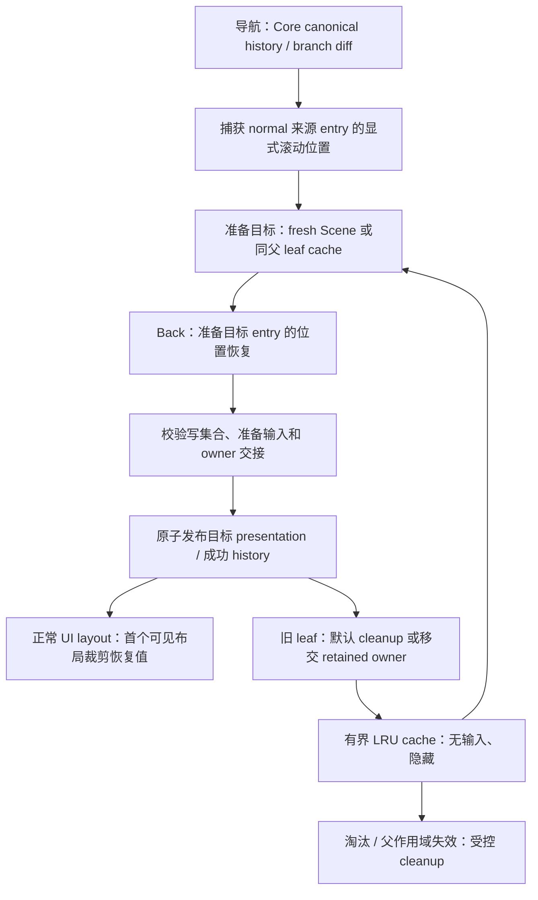

# 页面保留与滚动恢复设计

**状态：功能范围、行为与技术方案已由用户确认；实施中，尚未交付。** 实施顺序与验收进度见[实施计划](plan.md)。

本轮在现有同步路由基础上增加两项能力：按 history entry 恢复滚动，以及同一保留父布局下的 leaf keep-alive。当前不支持浏览器，不建设 URL/history adapter。异步 factory、过渡动画、任意分支缓存不在本轮范围。

现行基线见[导航合同](../../contracts/navigation.md)、[Scene 合同](../../contracts/scene.md)、[生命周期](../../contracts/lifecycle.md)和[输入/focus](../../contracts/input-focus.md)。本设计描述待扩展部分，不声明现有运行证据已经覆盖它们。[原范围比较](scope.md)仅保留选型依据；交付范围以本页为准。

## 1. 目标与方案选择

用户返回先前访问时，恢复那次访问的滚动位置；在同一个父布局内往返页面时，按配置复用原 leaf Entity 和局部组件状态。两个目标独立成立，也必须能正确组合。

采用独立的 entry 滚动记录与受限页面实例缓存：前者标识一次访问，后者标识可以复用的页面。应用自己实现全部恢复会重复路由身份与离场时序处理；每 entry 缓存整条分支则显著扩大 ownership 与内存范围。首版不选择这两种方案。

基础能力的两项改进另行评估：search 更新时的布局保留/输入更新，以及标准 Tab/InputDispatch 接线。本设计不悄悄改变现有 search 整链重建规则，也不将通用 query 更新框架作为两项功能的前置。keep-alive 必须验证实际使用的输入管线；标准插件若纳入示例，须完成对应过滤，不能只安装插件。

## 2. 按 history entry 恢复滚动

### 2.1 身份与显式接入

- 容器通过公开 marker 显式加入，并提供 frame-local 稳定字符串 key；未标记容器遵循 Bevy/应用行为。首版支持同一页面多个容器与二维位置。
- 记录按 Router、不可伪造的 opaque history entry key、route 复用身份及容器 key 关联。key 不依赖 Entity、history cursor 或 URL 字符串。重复 URL 的不同 entry 独立；同一容器 key 在不同 route/frame-local 作用域可以重复。
- 沿 Core 已有私有 `HistoryEntryId` 提供受控只读投影和 publication 交接事实，不增加第二份 history。Replace 产生新 entry 身份，Back 使用目标既有身份。
- ECS 持有位置与 Entity 映射，Core 不依赖 Bevy 或保存像素数据。应用不能通过位置记录改变 history 或签发 lifecycle 权限。

### 2.2 保存、恢复和缺省行为

| 导航情况 | 行为 |
| --- | --- |
| 离开 normal 来源 | 在其失去有效内容前保存实际显示位置，绑定来源成功 entry；即使容器仍被 prefix 保留也保存 |
| Back 成功 | 恢复目标 entry 中显式容器的记录；适用于 fresh leaf、cache hit 和仍保留的父布局容器 |
| Push / Replace 成功 | 创建新 entry；fresh 容器使用 Scene 初值，仍存活或缓存复用的容器保留当前值，不继承旧 entry 的位置记录 |
| 目标 entry 没有容器记录 | 保持该容器当前值；fresh Scene 的当前值就是其初值 |
| normal 来源被失败呈现替换 | 仍保存原成功 entry 的离场位置；error/fallback 不写入成功 entry 的位置记录 |
| 导航失败且原内容保留 | 不恢复、不重置，也不产生目标成功 entry |

恢复以 history entry 为准，因此 Back 时**显式标记的 preserved prefix 容器也恢复**；未标记 prefix 保持当前值。这是对原范围草案“prefix 一律不重置”建议的收敛，不承诺每个 entry 拥有独立页面实例。

等价 location 的 Push/Replace 保持现有零物理 mutation；Back 若目标 entry 有不同的显式位置，则允许必要的滚动写入，不能再对这种 opt-in 情况承诺零物理写。history 与其他 UI 结构的等价行为保持不变。

同一 frame-local 作用域内重复容器 key 不能任意选择第一个：该 key 不保存/恢复，并给出有界诊断；不因此使本来有效的导航失败。非法/失去归属的容器不写入，位置不是扩大 mutation authority 的理由。

### 2.3 布局与记录回收

保存实际布局后的显示位置，统一换算成逻辑像素；不能直接把可能超出范围的 `ScrollPosition` 请求值当作实际值。恢复到 `ScrollPosition`，由 Bevy 正常 layout 裁剪到当前内容范围。Bevy 0.19.1 实际将裁剪结果写入 `ComputedNode`，不回写请求值：首次有效目标 layout 后，在 `UiSystems::Layout` 之后核对 exact frame/generation 和容器归属，单次将实际逻辑位置结算回 `ScrollPosition`，消费恢复请求。内容变短后采用裁剪结果，随后内容增长也不自动跳回旧请求位置。

查找、身份校验和目标值准备在 publication atomic tail 前完成；任何 marker/组件插入、可失败查找或布局工作不能放入 tail。同步 Scene 在首个目标 layout 前设置恢复请求，首次可见布局就反映恢复结果。保存事实和恢复请求都需要绑定 exact frame/generation，stale 请求不可写入新页面。

首版保证同步内容；发布后异步增长或应用延迟创建的容器不承诺自动追赶恢复。缺少 UI layout 的 headless 环境不产生伪造的实际位置；沿用 Scene 初值并诊断接线不足。不使用固定等待两帧、无限 polling 或强制运行额外 layout。

位置记录随 entry 生命周期回收：Replace 删除旧 entry 记录，Push 截断的 forward entries 删除，Router 移除释放全部记录。host loss 不删除仍在 canonical history 中的访问记录；重新建立有效页面后 Back 仍可按 entry 恢复。存储规模随现有 history 与显式容器数量，不额外保留已退出 history 的记录。

## 3. 同一保留父布局下的 leaf keep-alive

### 3.1 配置与命中

应用在 leaf route 显式启用缓存，Router 配置非活动实例容量；默认关闭。上限计算 cached leaf，当前 active 不占容量；容量为零等价于禁用。首版简单 LRU，以失活时刻形成最近使用顺序，超限淘汰最久未使用实例。

只有 normal leaf 可以缓存；所属 exact parent frame/generation、outlet、slot binding 与 host incarnation 必须仍有效且处于保留作用域。root 独立页面、带活动子分支的页面、error/fallback、失败或 quarantine 内容不缓存。

cache key 包含该父作用域内的 route/view 复用身份、params、raw search 和 raw fragment。相同 key 的不同 history entry 共享页面实例。仅 fragment 改变仍按现行合同重建 deepest frame，不将此次替换重新解释为旧实例命中。参数变化可以在父作用域保留时切换不同 key；search 变化当前重建父布局，旧 cache 随父作用域失效，不能跨重建命中。

命中后保留原内容 Entity、局部组件和应用资源 handles，不重复 factory 或 Scene apply；内部执行身份按新导航合法交接，不重放旧 task。未命中沿用 fresh Scene 路径。

### 3.2 生命周期、输入与应用协作

离场时同次撤销 pointer/历史 hover/已开始手势、keyboard/gamepad 资格与 focus，随后进入隐藏且不参与布局的 retained 状态。cached 内容不影响当前页面布局和输入，保留父布局及其他合法目标的输入。

Core 决定 retain/reactivate/dispose；ECS 持有物理实体与长期 retained owner。离场 owner 移交完成后原请求可终结，不能把长期 cache 挂在原请求的 outstanding task/capability 上。重新激活前验证完整 current/next、cache source、exact claim 与 target/protected partition；复用现有准备和原子发布协议。

retained shell 留在原 child slot 下，以独立 retained role/owner 登记，与该 slot 的当前 active frame claim 分开；不能继续伪装为 active 或 leaving。slot、outlet、active branch、输入 Refresh 和 cleanup 的验证均扩展识别 exact retained owner/claim 为合法 protected extras，不向它们授予 active 输入，也不允许任意 sibling。命中激活将指定 retained 对象纳入 authorized target，其他缓存仍 protected；任何触发 hook 的角色或组件写入后重建并复验完整 partition。先用机制探针验证现有 mount 与 frame-local closure 能按此边界扩展，再进入完整缓存实现，不靠 query 顺序或放宽所有 child-set 检查通过验证。

对应用仅提供一种最小活动资格查询入口，使页面系统可以按目标判断是否 active；不同时增加多套 marker/event/callback。隐藏不暂停任意 Query、timer、observer 或副作用。应用需要按此入口决定后台工作；Router 不冻结整个 World。

重新激活授予正常输入资格；无新的显式 focus 意图时不自动恢复历史 focus。恢复后的正常 pointer/keyboard 正向行为必须经生产管线验证，不能只断言“隐藏时 gate=false”。

### 3.3 淘汰与失败

容量淘汰、parent/outlet/slot 失效、host loss/readmission 都由明确 cleanup owner 结算缓存。parent 失效时不可先递归销毁仍由其他 owner 持有的 retained 内容；先完成受控责任交接与完整写集合校验。

cache entry 自身失效与 current authority loss 保持不同分类：前者在安全隔离和有界清理后可作为 miss fresh build；后者沿现行 authority recovery，不用“miss”掩盖。缓存命中准备失败必须返还或结算原 owner，不留下两个持有者。

命中页若已经物理写入而发布失败，必须重新检查完整事实并选择可证明安全的返还或隔离清理，不能依赖旧快照强行放回缓存。正常导航失败也不无理由清空仍有效父作用域内其他缓存。

首版不提供 TTL、字节预算、磁盘持久化、整分支缓存、跨父重建恢复或每 entry 独立实例。显式 cache invalidation API 不作为本轮前置；有真实数据刷新需求时独立定最小语义。

## 4. 组合行为

例如 entry E1 的 A 页面滚到 100，进入 B，再 Push A 得到 E3；E3 可以命中原 A 实例，但不是 E1。用户把 E3 滚到 500，Back 到 B，再 Back 到 E1 时，即使命中同一个 A Entity，也恢复 E1 的 100。

图表示语义数据流，不把源位置捕获后的记录更新当作 history 提交，也不表示发布后才安装 owner。所有 owner 组合和移交准备必须在 Ready 前完成；恢复组件写入同样遵守原子 tail 的限制。

## 5. 交付顺序、投入和验收

先完成滚动，再完成 leaf keep-alive，最后验证组合与实际窗口。滚动本身不依赖缓存；两个能力共用 canonical identity 和现行 publication/cleanup，不建设通用页面 runtime。按实际 seam 拆私有模块，不先整体重写 navigation。

| 可交付结果 | 估算 | 主要风险 / 收益 |
| --- | --- | --- |
| entry 滚动恢复 | 4–8 工程日 | 访问身份、normal/error 来源、真实布局单位与首次显示；返回列表直接获益 |
| 受限 leaf keep-alive | 10–20 工程日 | retained owner、失活/激活、动态内容及父作用域失效；复杂局部状态和高频切换收益较大 |
| 基础行为改进 | 单独定范围后估算 | query 更新与标准输入接线不能混作无条件依赖，也不能按小补丁承诺工期 |

估算含相关回归、consumer、窗口与独立审查；共用验证不机械相加，不承诺缓存一定提升整体性能。

滚动验收包括：重复 URL entry、Replace 新身份与记录回收、Back/cache hit/preserved prefix、多个容器、等价导航、失败替换与失败保留、缩放、内容缩短后再次增长不跳回、无记录与冲突 key、首次真实布局、host 重注册。

keep-alive 验收包括：A→B→A 同 Entity/局部状态且 factory 单次、LRU/禁用/淘汰后 fresh build、params/search/fragment 边界、稀疏 parent/outlet binding、多个缓存与 active 共存时正常 mount/input Refresh、失活期间动态内容、真实 pointer 与已开始手势撤权、focus 释放、恢复后正向命中、其他目标保留、命中准备/发布失败、parent/host loss 和后续请求收敛。

组合验收使用同 key 多 entry 的不同位置，分别覆盖 cache hit、miss 与淘汰；位置记录不能因共享 Entity 被覆盖到错误 entry。运行受影响完整 crate、最高层 public journey/facade/独立 consumer，并用现有应用内 BRP 在真实窗口验证；不操纵其他窗口，不增加无依据的平台矩阵。

性能至少比较默认关闭、cache miss/hit、idle、淘汰及连续往返，包含原本必须完成的 cleanup，检查活实体和 retained owner 稳定。当前大页面逐写复验成本单独测量，不能把 cache hit 绕开构建的收益冒充 miss 路径优化。

设计审阅后形成实施 plan，按上述独立交付结果安排代码、验证和提交；本页不是执行完成记录。
