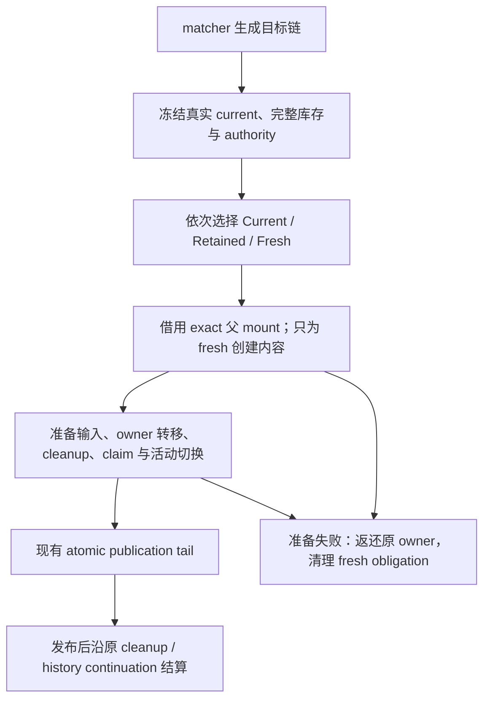

# 实例协调与当前路由输入

状态：当前只读输入与实例/owner 等价迁移已实现并通过完整门禁；父实例保留、独立子库存与依赖淘汰已实现并通过公开及完整 crate 回归，代表性能与发布收口仍待完成。本文定义本专题的行为与跨层接缝；现行行为见[导航合同](../../contracts/navigation.md)、[Scene 合同](../../contracts/scene.md)和[生命周期合同](../../contracts/lifecycle.md)。执行拆分见[实施计划](plan.md)，选型原因与其它专题见[长期评估](../navigation-experience/assessment.md)。

## 目标与范围

使布局和页面按实例存续，目标子页由 matcher 决定，存活实例能够读取本次已发布路由输入。代表行为是 `R/P/C → R/Q → R/P/D`：P 允许保留而 C 不允许时，保留 P 的 Entity、局部状态和 outlet，清理 C；返回时激活原 P，并为 D 正常选择实例或新建。准备 D 期间 P 仍隐藏且没有活动资格。

首批支持单条目标匹配链、default outlet、同 Router/host 和 exact 父挂载。保留候选仍须有正常父 frame 和有效 child slot；直接挂在 host 根部、没有正常父 frame 的页面暂不扩展保留。模型按实例和依赖组织，不以整组命中或全组 opt-in 固化该阶段限制。

本专题交付当前只读输入、父实例保留、独立子库存与依赖淘汰，保留现有 leaf 用户行为。原生 Tab/Dispatch 接线、滚动 ready/晚绑定各自独立设计；异步 Scene、transition、跨父搬移、跨 host、多 outlet、公开逐出命令不在本次实现范围。

## 模型与职责

| 概念 | 权威与持有者 | 含义 |
| --- | --- | --- |
| 目标匹配链 | Core matcher | 本次导航要显示哪些 route；库存不能恢复旧子页来代替匹配 |
| 存活实例事实 | Core | active 与 inactive 的实例、exact 父依赖、复用事实和保留顺序 |
| 物理实例与原 owner | ECS | 实例自身内容、自己拥有的 child slots，以及单一 lifecycle 责任 |
| 当前已发布输入 | Core 准备，ECS 查询 | 本次 presentation 的 location、该 frame 的 params、origin/failure |
| history entry | Core history | 一次访问；不充当实例身份，也不由库存另建 history |

统一存活视图由 Core 现有已发布 active 状态与 inactive 库存组成，不新增可独立修改的 active 链。Core 逻辑事实和 ECS 原 owner/payload 通过完整冻结投影核对，不合并成跨层可写状态表。View 保持 renderer-neutral；BSN 只构建 fresh Scene，不在激活时重放 factory。

实例身份复用 `RouteFrameVersion`，并绑定原 `HostVersion` 的实例/epoch；不增加第二套永久 instance ID。保留和激活保持原 frame、generation、slot；真实重建沿现有 allocator 分配或推进 generation，已消费身份不复用。

父依赖记录 exact 父 frame/generation、outlet、slot 与 mount binding。`branch_index` 只是本次目标链的位置，每次重新投影，不能作为库存身份。父可能 active 或 inactive，但必须存活且依赖链有效；不能再要求所有缓存实例的父都在 next active chain。

每份物理实例 payload 只拥有自己的 `RealizedFrame` 和 `slot.parent == 本实例` 的 slots。子内容由子实例独立拥有；子 mount 中的父 slot 是引用。清理 C 不删除 P→C 的 slot；销毁 P 则由 Core 先选定依赖闭包，再逐一移交原 owners，不能靠递归 despawn 代替责任结算。

## 目标选择与保留政策

目标按父到子推进，各位置的来源为 `Current`、`Retained` 或 `Fresh`。在首批 exact 父、单链范围内，来源顺序只能是 **active prefix → retained prefix → fresh suffix**，任一段可空：fresh 父有新身份，其旧子不可能精确命中。无需实现任意来源排列引擎。

选择优先级为：符合现行复用政策的当前实例、符合目标条件的库存实例、fresh。库存匹配核对 Router/HostVersion、normal origin、matcher provenance、route/view、segment reuse key 和 exact 父 binding。父的 reuse key 只含父自身 route-local params，不含旧子目标；父的旧完整 location 不能作为整组身份。

多个合法库存候选时，选择最近一次成功离场的实例，再以明确的 frame identity 排序消除同序歧义；未选候选继续受容量管理。同一 frame 或 owner 重复登记属于永久矛盾，不能当成多个候选或反复 retry。选择使用完整库存与当前 authority 的冻结投影，消费前重建并要求 exact equality。

`keep_alive: bool` 不继承，默认 false；容量默认 0。P(true)/C(false) 保留 P 并清理 C；P(false)/C(true) 因父被销毁而清理 C，C 不能跨父复活。P、C 均保留时分别持有原 owner/payload。隐藏实例及其 child slots 不声明 active child；publication 独立准备 next active slot occupancy。

### 现行变化默认值

| 输入变化 | 本专题保持的行为 |
| --- | --- |
| route-local params 改变 | 从受影响 frame 起替换后缀；不顺带放宽同实例复用 |
| raw search 改变 | 整条当前链重建；不因旧库存存在而绕过重建要求 |
| 仅 fragment 改变 | 保留祖先，重建最深 normal frame；同 frame/slot 推进 generation，禁用该次 leaf 命中 |
| 全部 canonical 输入相同 | 结构 no-op，history 按原命令处理；不制造物理 mutation |
| 普通库存激活 | 最深目标沿用 exact raw fragment 命中要求；祖先不以旧子 fragment 决定身份 |

每个成功 publication 都准备目标各层的当前输入，包括 preserved 和 activated 祖先。`RouteViewInput` 始终是 factory 执行的冻结快照，不更新应用保存的旧值。未来改变 params/search 默认值应单独裁决和估算，无需重新设计实例身份或输入接缝。

### 容量与依赖淘汰

容量按 inactive frame 计数，active 不计费；不按 Entity、slot、history entry 或整分支计数。先移除本次激活项，加入新离场保留项，裁定依赖失效，再按 LRU 淘汰直到满足容量。

已有 inactive 项保持原顺序；成功离场才更新顺序，失败准备不刷新 LRU。同次离场按深到浅加入，使新保留父晚于其子；稳定同序使用 frame identity。淘汰最旧候选时，若它是父则一起选择其 inactive 依赖闭包，因此可能释放多于一格；子可单独淘汰。next 选中实例及其父依赖受保护，不能为凑容量销毁它们。

该规则使容量 1 的 P(true)/C(true) 离场可留下 P、清理 C。使用现有标准容器和明确排序，不为简单 LRU 引入依赖或另一套缓存调度器。

## 当前只读输入接缝

已实现 renderer-neutral 的 `RouteInputRef<'a>` 借用视图，以及 ECS 只读 SystemParam。以下是第 1 步公共接口：

```rust
impl RouteInputs<'_, '_> {
    pub fn current<'a>(&'a self, target: Entity) -> Option<RouteInputRef<'a>>;
}

impl RouteInputRef<'_> {
    pub fn route(&self) -> Option<RouteId>;
    pub fn params(&self) -> &RouteParams;
    pub fn location(&self) -> &RouteLocation;
    pub fn origin(&self) -> &FrameOrigin;
    pub fn failure(&self) -> Option<&NavigationFailure>;
}
```

search/fragment 经 `location()` 读取，不再增设等价别名。中立输入值由 Core 维护，可供 View 使用；Entity 归属解析属于 ECS，`RouteInputs` 经 ECS facade/prelude 导出。引用只在 SystemParam 借用期间有效，不能跨 World mutation 或 await；复制普通数据不产生 owner 或 publication 权限。

`current(target)` 找最近的有效拥有 frame，返回其 route-local params 和本次 presentation 的完整 location。原生内容中后来增加的普通后代可查询；目标不需要自己携带路由组件。遇到最近的 retained、pending、leaving、quarantined 或失效边界即返回 None，不能继续向 active 祖先借资格。范围外返回 None，其它 Router 的有效内容按其自身 scope 解析。

复用 `RouteActivity` 的 exact active-frame 只读解析 primitive，前提是证明目的和失败语义相同；不复制 ancestry 循环，也不把控件输入资格等同于页面活动。它只读 Router 元数据和 hierarchy，应可与应用自身 `Query<&mut T>` 并用。消费者可在 `RouterScheduleSet::PublishSnapshots` 后观察本轮 publication。

输入可见时刻与 presentation/活动资格同时切换。准备期间旧 active 仍读旧输入，新建和库存内容读 None；成功 publication 后即可读新输入，不等 post-commit cleanup 或请求 terminal。stale/rejected publication 不能污染当前输入；结构 no-op 也不为同值输入增加物理写入。

已发布 error/fallback 也是 active presentation：location 是失败请求的位置，而不是成功 history 的位置。route-error 提供关联 route、其 local params、原 origin/failure；router fallback 为 route None、空 params、原 failure。`failure()` 按 frame 定义：normal 前缀为 None，错误/fallback frame 为原 failure；前缀保持自身 origin/params，location 更新为本次已发布 presentation 的位置。因此不能只从 history 或 `active().location()` 的成功值反推所有输入。

## 准备、发布与失败



### 混合来源准备

current 始终是真实 active 投影；选中的库存父单独记录，不能伪装成 preserved current。请求的 preparation 区分“已选择/验证的 target steps”和“本次 fresh 创建义务”，不再以 `applied_frames` 同时表达二者，也不把激活当成一次成功 fresh apply。

为 fresh D 使用库存 P 的原 outlet/slot 时，mount 证明仅允许**本请求已精确选择的** Retained/Hidden 父及 slot。不得全局放宽 retained mount。原 slot 保持 P 所有；不存在 slot 时沿现有 grant → stage → confirm 创建，publication 前归 preparation，失败由本次义务清理，成功后移交 P。任何触发 hook/observer 的写入后重建并复验 target/protected partition。

P 仍 Retained，D 是 PreparedInert。验证按实例自身 payload 与 child boundary 划分：P 的原内容 exact，D 的 prepared shell 和未选中的 inactive 子各有明确角色。不能套用旧 single-leaf 的“空 own slots、封闭 child set”校验排除合法受保护子库存，也不能为了满足 fresh branch 容器而复制 P 的物理 owner。

失败 source projection 也冻结选中的库存边界及原 owner 归属，不局限 host/active/fresh。即使 D 尚无输出，仍须区分 P 自身失效、fresh preparation drift 和共享 authority loss，按原 evidence/continuation 分流。

### Publication

沿现有 normal publication 接收器组合逐 frame/slot 的 current/next，取代全局 `Fresh`/`Retained` 二选一。先完成完整 target/protected partition、fresh 与 retained 原 owner 的组合、slot occupancy、claim rebind、cleanup reservation、容量和输入/focus/scroll preparation，再进入 Ready。

输入存储和 owner 接收器提前准备；atomic tail 仅作已准备好的不可失败原位切换，不新增组件插入、query、分配、排序或可失败验证，返回后不补装 owner。history/Back 使用原请求和 entry authority；缓存命中不另建导航状态机，滚动仍按目标访问选择记录。

### 拒绝、恢复与 authority loss

| 结果 | owner 与物理责任 |
| --- | --- |
| fresh 子构建或 preflight 拒绝 | 返还选中库存的同一个原 owner；只清理 fresh 内容、本次新建 slot 和已证明残留。库存父、原 slot、其它子库存保持 protected |
| 可重试 preparation 不足 | 保持原 owner 和冻结 source；仅可证明未来能完成的事实不足可 retry，永久矛盾有界拒绝 |
| 选中库存自身失效、共享 authority 仍有效 | 沿现有 OwnInvalid 分类冻结失效证据和原 owner，结算该实例及其依赖 closure；已挂在其下的本次 fresh 义务先由原 owner 清理，合法当前链和其它库存 protected。仅安全清理完成且原请求/任务 continuation 仍有效时，从该位置起 fresh，后代也 fresh；不把任意 drift 当普通 miss |
| route-error/fallback 恢复 | 按原 failure/attempt 选择 recovery；若接收选中的库存前缀，显式移交原 owner，否则返还。不得由 cleanup 数量反推 continuation |
| publication 前 host/authority loss | active、选中库存、其余库存和 fresh 义务进入现有 authority settlement，每个 owner 恰好一次；不发布 history，不先按 fresh 删除缓存父再重复清理 |
| publication 后或 idle authority loss | 保留已提交 history 和原结果；原 normal cleanup 已接收的责任保持原 token/ledger，仍 live 的实例才进入后续 authority 分区。idle 不重开旧请求，不按旧 current/next 重复汇总 |

失败清理借用 external mount 的精确边界，清除 fresh 子后恢复父 slot 的 Children/manifest bookkeeping。父淘汰与 authority loss 从冻结库存构建依赖 cleanup forest，child-first 汇总原 payload/owners；完成、停止清理、quarantine 和 readmission 继续沿现有协议。缓存父无需仍 active 才能结算。

## 替换边界与后续功能

| 现有耦合 | 本次替换方式 |
| --- | --- |
| Core single entering + `retarget_retained_leaf` | 目标逐实例选择；retained 不进入 fresh failure roots |
| `from_preserved_parent: bool` 和 applied suffix 推断 | 显式 Current/Retained/Fresh 父来源与完整 selection 投影 |
| ECS single hit、整 `RealizedBranch` 缓存 payload | 按实例自身持有；一个准备/发布/清理接收器消费原 owners |
| inactive scope 必须在 next active 中找父 | 在同一存活库存中核验 exact 父依赖链 |
| factory 快照被当作当前输入 | 保留 factory 合同，新增受控 published-input 查询 |

迁移时先保留必要 identity、owner、protected closure 和失败回归，再删除旧机制；leaf 是新协议的单实例特例，不长期并存两套缓存路径。只抽取本专题需要的实例选择、payload 和准备交接模块，不全库重写，不新增 runtime/crate。

异步页面将来消费 fresh task 与冻结输入，apply 必须核对 task 和完整 source；库存父可在等待期间保持 inert。过渡动画将来消费已选定实例与活动切换边界，leaving 视觉保留不授予输入，也不决定 history。两者可延后设计 API，不预建 loader、动画调度器或新的 lifecycle owner。滚动意图使用 entry 和实例归属，不能随同 Entity 再激活自动复用旧意图。

## 验收

1. **当前输入。** `/orgs/7/items/1 → /orgs/7/items/2` 的父 Entity、局部状态和 factory 次数不变；父/子 params 各属本 route，两者读新完整 location。factory 旧快照保持原值，应用 mutable Query 可共存。
2. **独立保留。** `R/P/C → R/Q → R/P/D` 覆盖 P(true)/C(false)、P/C 均保留、原 slot 与本次新 slot。确认原 P、fresh D、C 的清理/库存归属；最深 fragment 精确要求不迫使祖先换身份。旧 A/B/A leaf、LRU 和 Back 仍成立。
3. **依赖与容量。** inactive 父/子在尚未被选中时仍能作为合法 protected 库存跨其它导航存续；内部子可独立命中/淘汰。父淘汰带走依赖 closure，父 false 不能遗留子；容量 0/1 与多个合法候选均确定收敛，其它有效 Router 保持受保护。
4. **失败与可见时刻。** fresh 子拒绝、库存 OwnInvalid 后局部 fresh、带库存前缀的恢复及发布前/后 authority loss：原 owner 恰好一次返还或移交，无半激活或重复 cleanup；发布前不前移 history，发布后不撤回。pending/stale 不改旧输入；error/fallback 读失败位置；成功 publication 后、terminal 前可读新值。
5. **生产接入。** 真实 BSN/native 内容及动态后代通过 facade 查询；非活动、同 Entity 重新注册、失效父 mount 返回 None。保留已闭合 pointer/focus、entry 滚动组合和独立 consumer gate，不用该设计声称标准 Tab/Dispatch 已接通。

现行 params/search/fragment/no-op 回归属于上述门禁。验收只描述需要证明的行为；具体源码、命令、审查与提交归[实施计划](plan.md)，设计审查不充当运行成功证据。
