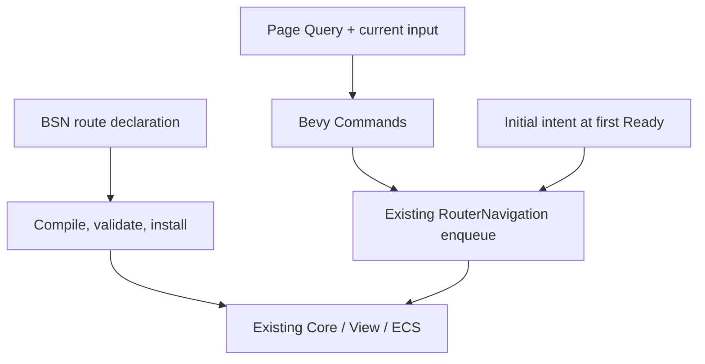

# Simpler router integration

[简体中文](design.md) | English

Status: in progress. Scope: BSN declaration and installation, ECS navigation and startup, examples, and an optional animation adapter. See the [plan](plan.en.md). Existing semantics remain in the [navigation contract](../../contracts/navigation.en.md), [Scene contract](../../contracts/scene.en.md), and [transition guide](../../guides/transitions.en.md).

## User outcome

An application associates paths and page factories in one declaration, supplies explicit layouts and outlets, and displays its configured initial page after installation. A page system can read current parameters, mutate application components, and navigate. Existing retention and scrolling remain available; applications design data loading and animation effects.

## Declaration and installation

`BsnRouter` owns one explicit root `BsnRoute`. `page(path, factory)`, `layout(factory)`, and `index(factory)` represent path, pathless, and index routes. Children, error factories, retention, and search reuse options belong to their route declarations. `fallback(factory)` supplies Router error presentation.

The existing ECS BSN bridge compiles declarations into a Core `RouteTree`, View registry, and factory bindings, then uses the shared installation path. Factories erase their heterogeneous types at declaration. Generated internal keys avoid other routers and manual registrations in the same App; errors identify the declaration. A failed install does not leave some of its factories registered.

Applications still create their hosts; layouts explicitly declare `DefaultOutlet`. No implicit parent frame is inserted. Retention capacity, search reuse, and error defaults stay unchanged. Manual registry/driver installation remains an advanced entry point.

## Addresses, commands, and startup

`RouteLocation::from_address` and string conversions split internal addresses into path, search, and fragment: first the first `#`, then the first `?` preceding it. The new entry point removes delimiters and distinguishes missing and empty values. Paths use existing normalization; no URL decoding, dot-segment resolution, or query sorting is added. `new` and raw setters retain their behavior.

`commands.router(handle).push/replace/back` defers calls to the existing `RouterNavigation` through Bevy Commands. Current-input queries remain read-only and coexist with application Query and Commands. Real request IDs are allocated at enqueue time; same-update publication is not promised. Enqueue failures are visible through a Bevy error handler, which applications may replace. Keep direct `RouterNavigation` for immediate IDs or synchronous error decisions.

`initial(location)` is an optional, one-shot default startup intent. It submits through the existing navigation entry point after the first Ready state. An explicit navigation successfully enqueued earlier consumes the unsubmitted default. Host registration does not replay it. A permanent enqueue failure is reported once and consumes the intent.

## Page systems and animation

Prefer existing `RouteInputs.current(entity)`, which already checks activity. Examples explain creation inputs versus current inputs, search updates, reactivation, and dynamic-content readiness. Any scroll helper captures the original restore ID at the call; no activity mirror, data-loading framework, or generic RouteQuery is introduced.

An optional animation adapter implements `RouteTransitionDriver` and coordinates third-party controllers with sessions. Applications supply effects, curves, durations, and layout policy. Verify `bevy_tween` independent controllers, post-publication startup, completion, and synchronous cancellation before exposing integration. Animation dependencies stay out of Core and default features. The manual driver remains available for custom systems.

## Validation and completion

Use ordinary App updates for three primary journeys: install heterogeneous nested routes and show the initial page; read parameters, mutate components, and navigate in one system; preserve explicit startup choice and avoid replay after host registration. Keep existing request, history, retention, scroll, and transition regressions.

Migrate recommended examples and an independent consumer; update bilingual guides and architecture entry points. Validate animation start, completion, and cancellation separately and reuse existing transition journeys. The usage layer adds no independent navigation state or per-frame registry polling. On completion, migrate lasting semantics into existing contracts and guides; Git retains this design and plan.
