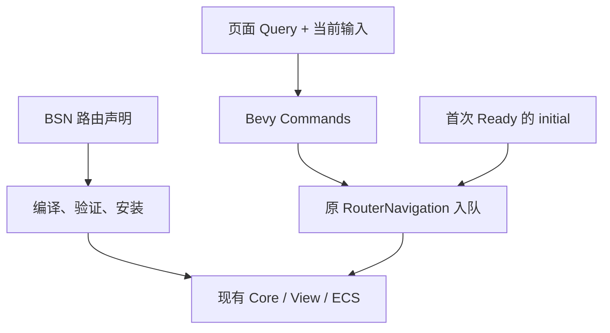

# 简化路由接入

[English](design.en.md) | 简体中文

状态：实施中。范围：BSN 声明与安装、ECS 导航和启动、使用示例、可选动画适配。执行顺序见[计划](plan.md)。现行语义见[导航合同](../../contracts/navigation.md)、[Scene 合同](../../contracts/scene.md)和[过渡指南](../../guides/transitions.md)。

## 用户结果

应用在一个声明中关联路径和页面 factory，明确布局与 outlet，安装后即可显示指定初始页。页面系统可以读取当前参数、修改应用组件并导航。保留和滚动继续使用既有能力；具体加载和动画效果由应用设计。

## 声明与安装

`BsnRouter` 持有一个明确的根 `BsnRoute`。`page(path, factory)`、`layout(factory)` 和 `index(factory)` 分别表示 path、pathless 和 index；子路由、错误 factory、保留与 query 复用选项直接挂在对应声明上。`fallback(factory)` 是 Router 的错误呈现。

现有 ECS 的 BSN bridge 将声明编译成 Core `RouteTree`、View registry 和 factory bindings，再使用共同安装路径。异构 factory 在声明入口擦除类型。生成的内部 key 在同一 App 中不与其它 Router 或手工注册冲突；错误携带声明位置。安装失败不留下本次声明的部分 factory 注册。

应用继续创建 host，layout 明确声明 `DefaultOutlet`。不插入隐式父 frame，不改变 keep-alive 容量、query 复用和错误呈现默认行为。手工 registry/driver 入口保留为高级装配方式。

## 地址、命令与启动

`RouteLocation::from_address` 以及字符串转换只拆分内部地址的 path、search、fragment。先分离第一个 `#`，再分离之前的第一个 `?`；新入口去掉分隔符，保留缺省与空串差别。路径沿用现有规范化，不进行 URL decoding、点段消解或 query 排序。`new` 与 raw setters 保持原行为。

`commands.router(handle).push/replace/back` 通过 Bevy Commands 延迟调用现有 `RouterNavigation`。当前输入查询保持只读，因此可和普通应用 Query、Commands 共存。真实 request ID 在实际入队时生成；此入口不承诺同帧发布。默认入队错误通过 Bevy error handler 可见，应用可替换处理器。需要同步 ID 或立即分支处理错误时使用原 `RouterNavigation`。

`initial(location)` 是可选的一次性默认启动意图。首次 Ready 后通过原导航入口提交；此前成功入队的显式导航取消尚未提交的初始意图。host 重新注册不重放。不可恢复的入队错误报告一次并结束该意图。

## 页面系统与动画

优先使用现有 `RouteInputs.current(entity)`，它已包含活动资格判定。示例说明创建时输入和当前输入、query 更新、保留页重新激活及动态内容 ready。任何滚动帮助方法都必须捕获调用时的原 restore ID；不新建活动镜像、数据加载框架或泛型 RouteQuery。

可选动画适配继续实现 `RouteTransitionDriver`，只收拢第三方动画控制器与 session 的协调。应用提供效果、曲线、时长和布局策略。先验证 `bevy_tween` 的独立控制器、发布后起播、完成和同步取消，再决定公开接入；不将动画依赖加入 Core 或默认 feature。原手工 driver 继续用于自定义系统。

## 验证与完成

通过普通 App 更新验证三个主要旅程：异构嵌套路由安装并显示初始页；同一系统读取参数、修改组件和导航；显式启动选择与 host 重接不重复初始导航。保留已有请求、history、缓存、滚动和过渡回归。

迁移推荐示例和独立 consumer，整理双语指南和架构入口。动画适配另验证开始、完成、取消，复用现有过渡旅程。新增使用层不增加独立导航状态或每帧轮询注册表。完成后将长期语义迁入原合同与指南，本设计和计划由 Git 追溯。
