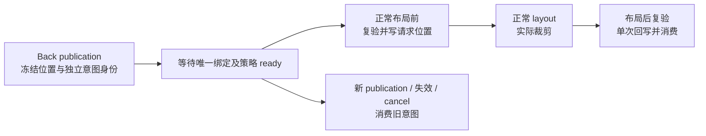

# 访问级滚动恢复意图

状态：待实施，行为范围沿已确认的[长期方向](../navigation-experience/assessment.md#统一的访问级滚动恢复意图)。本文定义待改变部分，当前行为仍归[导航合同](../../contracts/navigation.md#按访问恢复滚动)。公开接口名为实施设计，尚未导出；执行顺序见[计划](plan.md)。

## 问题与完成标准

返回应恢复**那次访问**的位置，即使内容尚未就绪或容器在 publication 后才创建。现实现只为 publication 前已有容器恢复首布局：早容器范围不足会过早裁剪，晚容器没有请求；随后采样还可能用初值覆盖目标 entry 的原记录。

早、晚容器使用同一套意图、绑定、就绪、取消与单次结算。默认仍自动尝试首个正常布局；需要加载或动态范围的应用可以显式 ready。新 publication、归属失效或应用取消使旧意图失效，应用主动滚动优先；内容之后增长不自动追赶旧目标。导航终态不等待内容就绪。

## 职责与减法

- Core 沿用 canonical entry、history publication 和 exact frame/reuse facts，不持有容器或加载状态。
- ECS 的 `scroll` 模块持有 entry 记录、冻结意图、绑定和执行；查询复用 `ActiveRouteScope`。拆分模块仅在记录/执行责任确需分离时进行，不另建协调层。
- Bevy UI 负责正常 layout 和裁剪。应用负责内容、ready、滚动政策与自己的异步任务；Router 不猜测内容稳定、不额外跑 layout。

保留既有二维逻辑像素、frame-local key、重复 key 排除、history 记录回收、错误/host loss 行为。替换现有 `Restoration { container, original }` 绑定中心模型；不并存一套晚容器状态机，不增加 lifecycle owner、loader、控制 Resource 或第三方缓存库。

## 记录、意图与绑定

| 数据 | 生命周期与唯一职责 |
| --- | --- |
| entry 记录 | canonical entry + segment reuse key + container key → 最近有效显示位置；随 history 回收 |
| 恢复意图 | 本次 publication 的独立身份、entry、exact target frame/reuse key、container key、冻结目标位置；不依赖容器已出现 |
| 容器绑定 | 原 Entity、exact frame、key/策略和绑定时位置；只绑定一次，作为执行前后复验对象 |
| live 显示见证 | 当前有效布局观察；未完成意图的 key 不得用初值覆盖其冻结值或 entry 原记录 |

成功 Back publication 从目标记录创建意图，同时冻结 target frame 归属；保留可用的早容器绑定，尚无容器的意图保持未绑定。Push/Replace 与无记录的 key 不创建恢复意图。后续第一次发现唯一、有效且 active 的同 frame/key 容器时绑定；不能向 active 祖先借归属。

ID 是可复制的只读关联标识，不是 lifecycle capability。每次 publication 都有新的内部实例身份，不能仅由 entry/frame/Entity 推导；同 entry、同 Entity 再次 Back，旧 ID 仍失效。准备期完成身份和数据分配，publication 只安装准备好的状态。控制 ID 的复制不能重建 authority，实际写入始终复验当前归属。

新 publication 撤销全部旧意图；入队、未发布的准备或失败本身不取消当前意图。已绑定容器离开 frame、失效或其 key/策略改变，消费该意图，不跟随替代 Entity 重绑。重复 key 排除本次恢复并诊断，其它 key 不受影响。

等待期间，live sampling 和离场 source 保存跳过未完成 key，保留原 entry 记录；其它容器正常采样。完成或明确取消后恢复普通采样，后续看到的是实际显示位置。冻结值不从 mutable records 再读，避免 ready 前初始布局覆盖目标。

## 公共接缝与调度

保留 `RouteScroll::new(key)` 的默认自动策略，增加显式 ready 策略。只读 `RouteScrollRestorations::pending(scope_entity, key)` 返回冻结位置与 opaque ID；scope_entity 是该 active frame 内的现有内容，所以晚容器尚不存在也能查询。沿 `Commands` 扩展提供 `ready_route_scroll(id)` 和 `cancel_route_scroll(id)`，stale/已消费 ID 无效果。不公开 entry/frame 构造器，不要求应用维护第二张恢复表。

公开 `PostUpdate` 中的 `RouterScrollSet::Prepare`，位于 `UiSystems::Content` 后、`UiSystems::Layout` 前。新结构在 `Update` 或 `UiSystems::Prepare` 前创建并完成 deferred 写入，使相机/目标等正常 UI propagation 先完成；ready 和已有组件的数值更新在 Router Prepare 前生效。应用若要改写本次自动恢复值，可在 Router Prepare 后、Layout 前运行。Commands 经 Bevy 正常 deferred 同步生效；布局后沿现有 settle 接缝复验并单次回写裁剪位置。

请求位置的物理写入从 publication tail 移到 Router Prepare，默认首布局的最终恢复结果保持。publication 后、Prepare 前立即读取 `ScrollPosition` 可能仍得到原值；要观察本次恢复请求值的系统明确排在 Prepare 后，实际显示位置在正常 Layout 后读取。现有布局前观察和示例同步调整排序，这部分按行为时序变化审查。

自动策略在绑定后允许一次尝试；显式策略只有当前 ID ready 后才尝试，ready 可先于晚容器出现。实际布局/相机见证仍须成立；缺失时沿现行合同一次放弃并保留原值，不重试固定帧数或等待范围增长。ready 表示应用允许尝试，不能伪造布局成功。

绑定后等待期间，应用改变 `ScrollPosition` 取消未执行恢复并进入普通采样；执行后再改变值，则布局后不回写。等值赋值和绑定前的应用意图无法从数值推断，需要明确 `cancel(id)`。取消只阻止尚未发生的恢复，不回滚应用值或已完成布局。

## 验收边界

以既有公开 BSN 和真实 UI layout 为入口，重点闭合：

- 早容器显式等待，初始布局范围小；ready 后恢复冻结位置，随后增长不再跳动。
- Back publication 后创建晚容器；同一意图经自动/显式策略绑定并单次执行，导航早已终结。
- 同 Entity、同 entry 反复 Back，旧 ID 无效；绑定后替代容器不继承旧意图。
- 等待时的应用滚动、绑定前取消及执行后改写优先；离开未完成恢复再返回，原 entry 记录没有被初值覆盖。
- 父库存激活/新子、entry Back 和失去当前 host/frame 归属组合；保留现有默认首布局、duplicate key、失败/history 和 readmission 回归。

新接口经独立 facade consumer 与示例使用；完整 ECS/facade 门禁、最终窗口及打包要求归[验证指南](../../development/verification.md)。不扩展 loader、虚拟条目锚定、多 outlet 或新的平台矩阵。
