# Route transition lifecycle

[中文](design.md) | [English](design.en.md)

Status: **In progress.** This document defines planned functionality. Current behavior remains defined by the [navigation](../../contracts/navigation.en.md), [lifecycle](../../contracts/lifecycle.en.md), and [input](../../contracts/input-focus.en.md) contracts. See the [plan](plan.en.md) for implementation order.

## User needs and responsibilities

Applications should be able to arrange their own enter and exit animations during navigation, reliably obtain the old and new views for that change, and let Router finish retention or cleanup when the exit effect ends. Retained-instance hits can participate, and animations preserve shared layouts. Applications without animations keep ordinary navigation behavior.

| Owner | Responsible for | Does not replace |
| --- | --- | --- |
| Core | Routing/history, instance selection, publication, and settlement of the original lifecycle obligations | Animation state machines, time, and rendering |
| ECS | Exact old/new views, controlled visual lifetime, input revocation, receiving completion/cancellation, and final disposition | Application animation orchestration |
| Native UI integration | Authorized presentation surfaces, input isolation for visible inactive content, and normal layout scheduling | General picking, layout, or animation algorithms |
| Application and animation library | Effects, properties, duration, curves, enter/exit ordering, reduced-motion preferences, execution, and redraw | Route commits, cache selection, and entity destruction |

Router includes no built-in slide/fade presets, does not associate Push/Replace/Back with a particular effect, and does not disable an entire region as a substitute for isolating departing content. Concrete effects appear only in the application example.

## Minimal integration contract

1. **Preparation before publication.** An optional application driver receives the route change, stable session identity, entering/leaving targets, and preserved common scopes. It prepares the initial presentation before the first visible frame. This happens in fallible preparation and is followed by revalidation; application code is not called in the atomic publication tail. Every preparation has a presented or cancelled outcome, including an application-session exit when publication fails.
2. **Publication notification.** The new route, history, current inputs, and activity still take effect at one publication point. The application starts its enter effect from an explicit published notification, rather than inferring activation from a factory call or request termination.
3. **Exit lifetime.** The application may request that the departing views remain visible temporarily. Old content immediately loses routing input and focus. The lifecycle owner stays inside Router; external code receives only an opaque completion credential for this change and controlled visual targets.
4. **Completion and cancellation.** The application stops its old animation writes before reporting that the departing views are no longer needed. Router settles the already-selected retain/dispose decision. Cancellation revokes only the extended visual lifetime, not the published navigation. Notifications from an old session cannot finish a new session.
5. **Default pass-through.** No driver, an application decision to skip, or no actual content replacement produces no animation wait. Equivalent navigation retains its existing zero-physical-mutation behavior. An enter animation alone does not require extending the routing request.

Concrete Rust names will follow runnable integration. The interface should remain smaller than the implementation: one driver seam, one read-only context, completion/cancellation entry points, and the necessary presentation surfaces. It neither duplicates routing state nor introduces a general timeline.

Applications may manipulate content they authored. To control the whole page's layout, they use an explicitly authorized presentation surface. Router retains control of structural relationships, presence/display, ownership, and input eligibility. Exposing a private shell Entity does not authorize arbitrary structural mutation, and trusted application code is not treated as a sandbox.

## Navigation, visuals, and obligations are separate dimensions

- Publication means navigation has taken effect; the visual effect may still be running.
- `RequestStatus` continues to express whether the original foreground obligations have settled. If the application asks an old instance to remain alive, exit disposition is still outstanding and the terminal state may be delayed accordingly. Request status is not an animation start/end event.
- The application may continue an enter effect after the request terminates. Only an actual extension of an old instance's lifetime creates a Router exit obligation.
- An application session's write lifetime is separate from the exit owner. Enter animations and sessions whose exit obligation has already been released still need management. Once another navigation for the same Router is accepted, synchronously cancel old sessions that retain write authority over related targets, revoke their extended exit lifetime, then advance using the existing sequence. Router neither fast-forwards an application effect nor drops or reorders navigation commands.
- Cancellation and completion must settle before an instance is reused by the next navigation. This design does not introduce a cross-request inventory of old views held beyond request termination.
- Host or authority loss immediately revokes the extended visual lifetime and enters the corresponding original obligation settlement. It neither waits for animation time nor changes published history or result classification.

The cancellation callback must stop subsequent application-driver writes and clear the application's session records before targets are reused or cleaned up. If preparation ran but publication did not, the application restores only presentation values it changed that still belong to that session. Router does not roll back arbitrary application resources. An asynchronous notification or invalidated completion credential alone is insufficient to complete cancellation.

## Instance and cleanup seams

The current cleanup manifest freezes the normal-content closure before publication, and history binding directly pairs the full `CleanupBatchToken`. Simply delaying the existing ledger would turn legitimate content updates during animation into stale cleanup, so it is not a viable implementation.

Separate two kinds of facts:

- **Obligations decided at publication:** original execution/instance identity, exact mount, exit scope, retain/dispose/retire partition, and the unique owner.
- **Write set determined at actual disposition:** current containment, deletion targets, protected scopes, manifest digest, and receipts.

First separate stable obligation identity from the concrete deletion seal, retaining the immediate path's existing exact validation. Prepare and install the exit owner before publication. After the application releases the view, revoke presentation eligibility, observe current content from the original owner, and issue the real deletion token for the first time. Do not insert an empty manifest as a placeholder and later change the token.

Parent retention and child cleanup keep their original obligations separately. When the whole old view must remain visible, its children cannot be deleted early. A departing instance becomes a hittable Live cache entry only after exit handoff completes; previously hidden cached content remains hidden. Host loss before sealing has its own controlled receiving entry point and cannot fake normal cleanup completion to reuse a failure path.

```mermaid
flowchart LR
    Prepare["Original owner / targets and disposition preparation"] --> AppPrepare["Application initial presentation preparation"]
    AppPrepare --> Validate["Revalidate and prepare publication"]
    Validate --> Publish["Publish new route / revoke old content input"]
    Publish --> Present["Application runs its effects"]
    Present --> Release["Complete or cancel extended exit lifetime"]
    Release --> Observe["Original owner observes current content"]
    Observe --> Dispose["Real cleanup seal / retained handoff"]
    Dispose --> Terminal["Original obligations settled"]
```

## Native UI, input, and scrolling

Visuals, activity, and input eligibility are represented separately. The new page receives input and valid focus under the current active semantics. Keeping the old page visible does not reactivate it. Applications may choose their own interaction policies; Router does not force the entire animation region to be disabled.

Official Bevy UI picking stops collecting candidates at blocking nodes. Filtering after hover is therefore insufficient to ensure positive hits on the new page underneath. Use a narrow adapter: before the official Backend, project the public `UiStack` candidates and partition using exact inactive content; restore them after the Backend, then continue through official hover/interaction. This does not modify authored `Pickable`, duplicate the picking algorithm, or depend on a particular clipping layout for animations. Independent real-input probes have verified overlapping pages, hits across clipping boundaries, and dynamic descendants. Production integration still needs public-journey coverage.

The application chooses presentation-surface layout and transforms. Existing complete canonical-shell validation should recognize the presentation state authorized for this change; it must not simply be removed. Add a wrapper or separate rendering layer only when real integration shows it is necessary.

Scrolling continues to follow history entries and current normal layout without waiting for animations to end. Animations must not change restoration-target identity or treat transformed coordinates as scroll positions. Dynamic content readiness continues to use the existing ready/cancel seam. Legitimate background content changes remain allowed during the extended exit lifetime.

## Modules and dependencies

- Keep Core obligation identity, deferred exit, and seal conversion together under the owner protocol, rather than adding animation concepts or clocks to large navigation branches.
- Add a centralized transition module in ECS, separating application integration, presentation preparation/sessions, and exit handoff internally. Navigation orchestration calls these seams.
- Place native candidate filtering in the input integration module, using Router-provided eligibility without taking over or rewriting Bevy picking.
- Add no new crate or second renderer framework. Core/View remain renderer-neutral; concrete UI types stay in ECS/native integration.
- Prefer Bevy `Time`, `EasingCurve`, and `UiTransform` in the example. `bevy_tweening 0.16` and `bevy_tween 0.13` are application-side options, but neither replaces the exit owner or cancellation handoff. Add a runtime dependency only when it provides a net benefit.

## References and verification scope

[Vue Router](https://router.vuejs.org/guide/advanced/transitions.html) lets applications compose route views with a general Transition. [Vue hooks](https://vuejs.org/guide/built-ins/transition.html#javascript-hooks) and [Motion presence](https://motion.dev/docs/react-animate-presence) illustrate enter/exit and completion handshakes. [Web View Transitions](https://www.w3.org/TR/css-view-transitions-1/#viewtransition) distinguish the update from visual completion; skipping the effect does not cancel the state update. These responsibility boundaries inform this design, without copying DOM, CSS, or framework scheduling.

The design work has checked local official Bevy 0.19.1 and the production paths. Input-candidate projection has independent probe evidence; application integration and late sealing still need runtime evidence. Screenshots are not a ready replacement: official Screenshot uses CPU readback, and a UI target camera applies to the layout root. This feature does not prebuild subtree capture or a new rendering pipeline.
