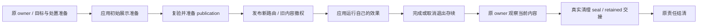

# 路由过渡生命周期

[English](design.en.md) | 简体中文

状态：实施中。本文定义待交付能力；当前行为仍以[导航](../../contracts/navigation.md)、[生命周期](../../contracts/lifecycle.md)和[输入](../../contracts/input-focus.md)合同为准。实施顺序见 [plan](plan.md)。

## 用户需求与职责

应用应能在页面切换时自行组织进入、退出动画，可靠取得本次新旧视图，在退出效果结束后让 Router 完成保留或清理。缓存命中也能参与，公共布局不因动画重建。未接动画时沿用普通导航。

| 归属 | 负责 | 不代替 |
| --- | --- | --- |
| Core | 路由/history、实例选择、发布与原生命周期责任的结算 | 动画状态机、时间和渲染 |
| ECS | exact 新旧视图、受控视觉存续、输入撤权、完成/取消接收及最终处置 | 应用的动画编排 |
| 原生 UI 接线 | 可授权的展示表面、可见非活动内容的输入隔离、正常布局调度 | 通用 picking、布局或动画算法 |
| 应用及动画库 | 效果、属性、时长、曲线、进出顺序、减少动态效果偏好、运行与重绘 | 路由提交、缓存选择和实体销毁 |

不内置滑动/淡出预设，不把 Push/Replace/Back 与某个效果绑定，也不以整区禁输入代替离场隔离。具体效果只出现在应用示例。

## 最小接入合同

1. **发布前准备。** 可选应用驱动取得本次路由变化、稳定会话身份、entering/leaving 目标及保留的共同作用域，在首次可见前完成初始展示准备。准备发生在可失败 preparation 中，随后重新校验；不在 atomic publication tail 调用应用代码。每次准备必有 presented 或 cancelled 出口，发布前失败也要结束应用会话。
2. **发布事实。** 新路由、history、当前输入和 activity 仍在同一个 publication 点生效。应用由明确的已发布通知启动进入效果，不能靠 factory 调用或 request terminal 猜测激活。
3. **退出存续。** 应用可申请暂时保留本次退出视图的显示。旧内容立即失去路由输入与 focus，生命周期 owner 留在 Router 内部；外部只获得不透明的本次完成凭据和受控视觉目标。
4. **完成与取消。** 应用先停止自己的旧动画写入，再报告不再需要退出视图。Router 按已经确定的 retain/dispose 决策结算。取消只撤销视觉存续，不撤销已发布导航；旧会话通知不能结束新会话。
5. **默认直通。** 未安装驱动、应用选择跳过、没有实际替换内容时，不制造动画等待；等价导航保持现有零物理 mutation。进入动画自身不要求延长路由请求。

具体 Rust 名称由可运行接线确定。接口应小于实现：一个驱动接缝、一份只读上下文、完成/取消入口和必要的视觉表面，不复制路由状态或引入通用时间线。

应用可操作自己 authored 的内容。需要控制整个页面布局时，使用明确授权的展示表面；Router 仍保留结构关系、presence/display、ownership 和输入权限。不能把私有 shell Entity 的暴露解释成任意结构 mutation 权限，也不为此把可信应用代码当成沙箱。

## 导航、视觉与责任是不同维度

- publication 表示导航已经生效；视觉效果可以尚未结束。
- `RequestStatus` 继续表达原前台责任是否结清。若应用要求旧实例继续存在，退出处置尚未完成，终态可相应延后；它不是动画开始/结束事件。
- entering 效果可在请求终态后继续由应用运行；只有实际旧实例存续形成 Router 的退出责任。
- 应用会话的写入存续与退出 owner 分开；进入动画或已释放退出责任的会话仍需管理。新的同 Router 导航被接受后，同步取消仍持有相关目标写入权的旧会话，撤销旧退出存续，再按既有 sequence 推进。Router 不替应用快进某个效果，不丢弃或重排导航命令。
- 取消与完成必须在实例重新用于下一次导航前收敛。暂不建立终态后仍持有旧页的跨请求残影库存。
- host/authority 失效直接撤销视觉存续并进入对应原责任结算；不等待动画时间，也不改写已发布的 history/结果分类。

取消回调必须在目标重新使用或清理前停止应用驱动的后续写入，并清除该会话的应用记录。准备后未发布时，应用只恢复自己修改且仍归本会话的展示值；Router 不回滚任意应用资源。仅发送异步通知或作废完成凭据不足以完成取消。

## 实例与清理接缝

当前 cleanup manifest 在 publication 前冻结普通内容 closure，history binding 直接配对完整 `CleanupBatchToken`。直接延后现有 ledger 会把动画期间合法的内容更新变成 stale cleanup，不能作为实现。

需要区分两类事实：

- **发布时确定的责任**：原执行/实例身份、exact mount、退出范围、retain/dispose/retire 分区和唯一 owner。
- **真正处置时确定的写集**：当前实际 containment、删除目标、保护范围、manifest digest 与 receipts。

先拆稳定责任身份与具体删除 seal，保持立即路径原有 exact 校验。退出 owner 在发布前完成准备和安装；应用释放后先撤销展示资格，再从原 owner 观察当前内容，首次签发真实删除 token。不能先用空 manifest 占位再改 token。

父保留、子清理分别保有原责任；整段旧画面需要存续时，不能提前删掉子内容。待退出实例完成交接后才成为可命中的 Live cache，原来隐藏的缓存保持隐藏。尚未 seal 时的 host loss 有自己的受控接收入口，不能伪造 normal cleanup completion 来复用失败路径。

## 原生 UI、输入和滚动

视觉、activity 和输入资格分别表达。新页仍按当前 active 语义获得输入和合法 focus；旧页显示不使其重新具有活动资格。应用可选择自己的交互政策，Router 不强制整个动画区域禁用。

官方 Bevy UI picking 会在阻挡节点处截断候选，现有 hover 后过滤不足以保证下层新页正向命中。采用窄 adapter：在官方 Backend 前，以 exact 非活动内容投影公开 `UiStack` 候选与 partition，Backend 后恢复，再沿用官方 hover/interaction。它不改 authored `Pickable`、不复制 picking 算法，也不依赖某种动画裁剪布局。独立真实输入探针已验证重叠页面、跨裁剪命中和动态后代；生产接线仍需公开旅程覆盖。

展示表面的布局和变换选择属于应用。现有完整 canonical shell 校验应改为识别本次获准展示状态，不能直接删除校验。新增 wrapper 或独立渲染层只有在真实接线证明必要时才引入。

滚动继续按 history entry 及当前正常布局执行，不等待动画结束；动画不得更改恢复目标的身份或把变换坐标当作滚动位置。动态内容就绪继续使用现有 ready/cancel 接缝。合法的后台内容变化不因离场存续被禁止。

## 模块与依赖

- Core 的责任身份、deferred exit 与 seal 转换按 owner 协议集中，避免把动画名词/时钟塞进大导航分支。
- ECS 新增集中式 transition 模块，内部区分应用接入、展示准备/会话、退出交接；导航编排只调用这些接缝。
- 原生候选过滤放在输入接线模块，使用 Router 提供的资格，不独占或重写 Bevy picking。
- 不新增 crate 或第二个 renderer 框架。Core/View 保持 renderer-neutral；具体 UI 类型只在 ECS/原生接线。
- 示例优先复用 Bevy `Time`、`EasingCurve`、`UiTransform`。`bevy_tweening 0.16`、`bevy_tween 0.13` 可作为应用侧选择，但都不能替代退出 owner 与取消交接；没有净收益时不增加运行时依赖。

## 参考与验证边界

[Vue Router](https://router.vuejs.org/guide/advanced/transitions.html) 将路由视图交给应用组合通用 Transition；[Vue hooks](https://vuejs.org/guide/built-ins/transition.html#javascript-hooks) 与 [Motion presence](https://motion.dev/docs/react-animate-presence) 展示进入/退出及完成握手。[Web View Transitions](https://www.w3.org/TR/css-view-transitions-1/#viewtransition) 区分更新与视觉结束，跳过效果不取消状态更新。参考这些职责，不照搬 DOM、CSS 或框架调度。

本轮已核查本地官方 Bevy 0.19.1 和生产路径；输入候选投影已有独立探针证据，应用接线与 late-seal 仍须运行证据。截图方案不是现成替代：官方 Screenshot 经 CPU readback，UI target camera 作用于 layout root；不为该功能预建 subtree 捕获或新渲染管线。
