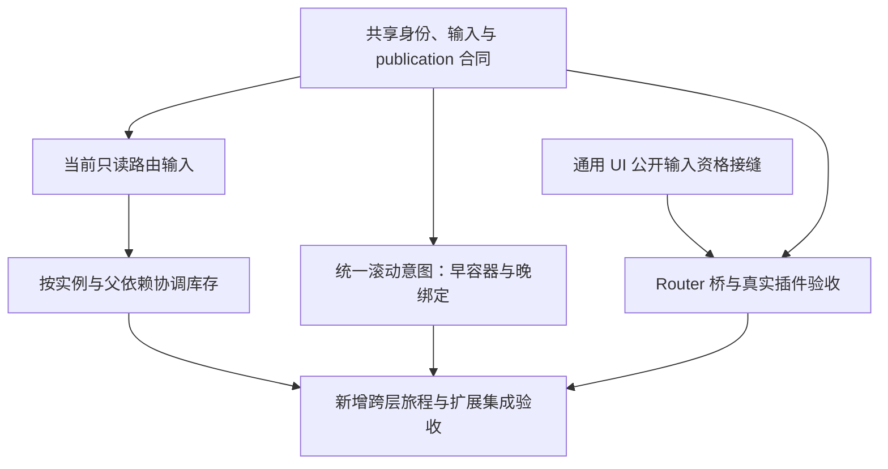

# 主线规划与发布

本页维护工作顺序、投入与交付边界；长期机制及职责见[评估](changes/navigation-experience/assessment.md)，现行行为归[专题合同](contracts/README.md)，运行证据归[验证指南](development/verification.md)。候选方向尚未实施，工作量是静态评估后的工程粗估，不是已确认 API 或排期承诺。

## 主线目标与当前阶段

交付可独立接入真实 Bevy UI、能够持续演进的通用嵌套路由库：布局和页面状态按实例存续，当前路由输入正确，输入资格与引擎管线一致，每次访问恢复自己的位置，失败与 host 变化有明确且有界的责任结算。

匹配、嵌套导航、history、同步 BSN、失败恢复及同父 leaf 保留、entry 滚动已经交付，具有组合、独立 consumer、窗口与性能证据。下一阶段解决已暴露的通用接线与模型限制；已完成计划由 Git 追溯，不重新打开旧 MVP 阶段。消费者反馈用于确认问题和验收，短期可接受不决定长期模型。

## 当前要完成什么

1. **收敛共享模型并进入实例协调交付。** [设计草案](changes/instance-coordination/design.md)明确 history entry、实例身份、当前输入、exact 父 binding、原 owner 和 publication 的关系；[实施计划](changes/instance-coordination/plan.md)安排“当前输入 → 等价迁移 → 父保留/混合准备 → 内部库存/淘汰 → 组合收口”。先复核关键责任轨迹，再沿同一管线实施；设计预算 2–4 人日包含这一收敛过程，文档形成不代表运行能力交付。不阻塞输入与滚动的独立设计。
2. **同时推进真实原生输入接线。** 用官方插件入口复现并确认候选、dispatch 与 focus 的调用时机，设计通用 UI 公开资格接缝及 Router 三分类桥。该工作计入下表输入专题，不等待全部库存能力，也不默认先建 hidden-helper 迁移桥。
3. **做一次有限性能调查。** 选代表内容规模和实际切换预算，测切换、命中及淘汰中的 cleanup 占比。已有 128 内容节点满容量 LRU 约 10 ms、且不含 layout/render 的结果足以安排调查，尚不足以选择优化方案。若已经越预算，相关局部修复应提前于扩大库存；否则随能力交付复测。[测量与边界](performance.md)
4. **准备独立发布范围。** 整理现行能力与限制、版本和授权待决项、最终树检查入口。发布准备可以并行，不将所有后续扩展自动升级为首次发布前置。

滚动专题可以同步设计访问级意图、绑定与内容就绪；实现等待最小身份/publication 合同确定，无须等待完整库存协调。

## 后续交付与依赖

下图是候选工作的依赖，描述未来交付顺序，不是当前 runtime 架构。

优先闭合实际原生输入旅程，可先对现有 leaf 库存验收；当前路由输入作为实例协调的基础交付。滚动可与库存实现错开，早容器 ready 和晚绑定分批开放，但从一开始使用同一意图机制。库存沿已有完成路径逐步交付父保留、子独立替换、内部子库存和依赖淘汰，不另建整组缓存状态机。

公开 UI 接缝若尚未进入可采用的官方依赖版本，补丁可审阅不等于 Router 发布依赖上的旅程已经闭合。上游等待不阻塞其它工作；是否追加迁移桥按交付时限与维护成本单独裁决，不强制消费者使用指定 fork。

首批范围可限单条目标链、default outlet、同 Router/host 和 exact 父作用域。它必须是长期机制的子集，不固化全组 opt-in、子不保留连带父 fresh 或只按旧子目标整组命中的语义。现阶段沿实例协调设计保留 params/search/fragment 默认行为；改变默认值另行裁决。

## 工作量、风险与 ROI

单位为熟悉仓库的开发者人日，含所属模块的必要回归、审查与文档；置信度为中到低。共享设计只计一次，跨专题最终组合与实例高层验收集中归属，输入/滚动自身验收仍包含在各自预算中。

| 工作 | 粗估 | 主要风险 | ROI 与安排 |
| --- | --- | --- | --- |
| 共享实例/输入/访问模型、关键责任轨迹 | 2–4 | 身份、generation 与 publication 关系选错会使后续返工 | 高；现在完成，为各专题提供最小稳定合同 |
| 通用 UI 输入资格接缝、Router 桥与本专题验收 | 8–14 | 原生排序/modal/dispatch/focus 组合；官方依赖可用时间不可控 | 高；立即独立推进，补实际接线缺口 |
| 当前只读路由输入接缝 | 4–7 | 构建快照与当前输入混淆，route-local params 或 publication 可见时刻错误 | 高；先于扩大实例复用交付，避免过期输入 |
| 统一访问级滚动意图及本专题验收 | 6–9 | 冻结记录被 live sampling 覆盖、晚绑定错归属、取消与应用滚动优先 | 高；合同稳定后可独立交付，早容器 5–7、晚绑定 1–2 已含在总数 |
| 按实例与父依赖的库存协调 | 10–16 | 混合激活/fresh、依赖淘汰、原 owner 返还、host loss 与局部 cleanup | 长期高、近期投入最大；模型收敛后实施，含相关局部重构 |
| 实例高层旅程、跨专题组合与最终扩展树验收 | 4–7 | 单项通过但输入、history、滚动、失败责任在交接处不一致 | 必需；随新增路径建立，最终统一收口，不留到末尾才找问题 |
| 代表性能调查与优化决策 | 1–2 | headless 耗时误当显示延迟，测量干扰或错误归因 | 决策 ROI 高；现在限额调查，真正优化据结果另估 |
| 首次发布准备与选定发布树检查 | 1–2 | 版本/授权待定、能力说明超出证据、包内依赖或示例装配问题 | 高；独立交付线，外部决策/等待不计入工程时间 |

前三个功能专题全部交付的粗略投入为 **34–57 人日**：共享模型、当前路由输入、库存与集中验收共 20–34；通用输入 8–14；滚动 6–9。性能调查与发布各 1–2 另计。这不是下一步立即投入或首次发布的总前置；不含上游等待、应用迁移、另建迁移桥、实际性能优化或尚未定型的公开实例逐出接口。

旧 exact 整组方案的分支 8–12、主线 17–26 人日已撤回。当前区间按不同时修改现有 params/search/fragment 默认政策估算；若设计决定改变这些政策，应重估增量，预算不能反过来约束长期选型。实例设计已给出按 frame 计费、原 payload 划分和有序混合准备；当前仍为静态粗估，首次实现交付后再用实际成本校准。

## 工程组织与减法

局部治理围绕 Core 实例选择/库存、ECS 原 owner/payload 准备转移及统一 publication/cleanup 接收器，计入所属交付。继续使用已有 matcher、history authority、BSN executor、frame-local 边界和 cleanup ledger；共享工具须保持相同证明目的与失败语义。没有证据支持全库重写或另建 runtime。第三方依赖优先采用能减少真实维护责任的引擎公开能力；简单 LRU 不因手写而单独换库。

设计与只读交叉审查可并行；实现按独立模块分工，共享 publication 的修改错开。结构重组和行为变更分开提交，每个交付都有相称的完整 crate 与已闭合最高层 gate。同一时刻一个 index/提交负责人、一个 Cargo/rustc 验证负责人；不将人日直接除以代理数量当作日历工期。

组合验收聚焦已有真实路径：父库存激活/新子 fresh、非活动子撤权、当前输入与 entry 同次正确、旧滚动意图不随相同 Entity 复活，以及一次准备期间 host loss 的取消与责任收敛。保留必要 leaf、普通导航、fallback/readmission 回归，不展开无目的反例矩阵。

## 首次发布与再下一阶段

发布针对选定最终树完成版本/授权、功能/features/consumer/打包检查、实际发布示例窗口冒烟和能力说明，然后按 crate 依赖顺序发布。当前尚未正式发布 crates.io，许可证与版本待确定；上传是单独动作。若只发布现行合同，未来扩展不自动成为前置；若承诺原生 Tab/Dispatch 集成，必须先闭合对应依赖和真实旅程。

发布后维护真实 consumer 与代表性能，优先处理已证实问题，再从[未交付能力](overview.md#核心需求与当前范围)选题。浏览器 URL/history、异步 Scene、typed route/search、transition、多 outlet 和其它 renderer 暂不排期；它们不解决当前主线的关键限制。Windows 原生、最低 Rust、物理 GPU 与硬件输入是现有证据边界，只在目标环境或实际差异需要时追加验证。
