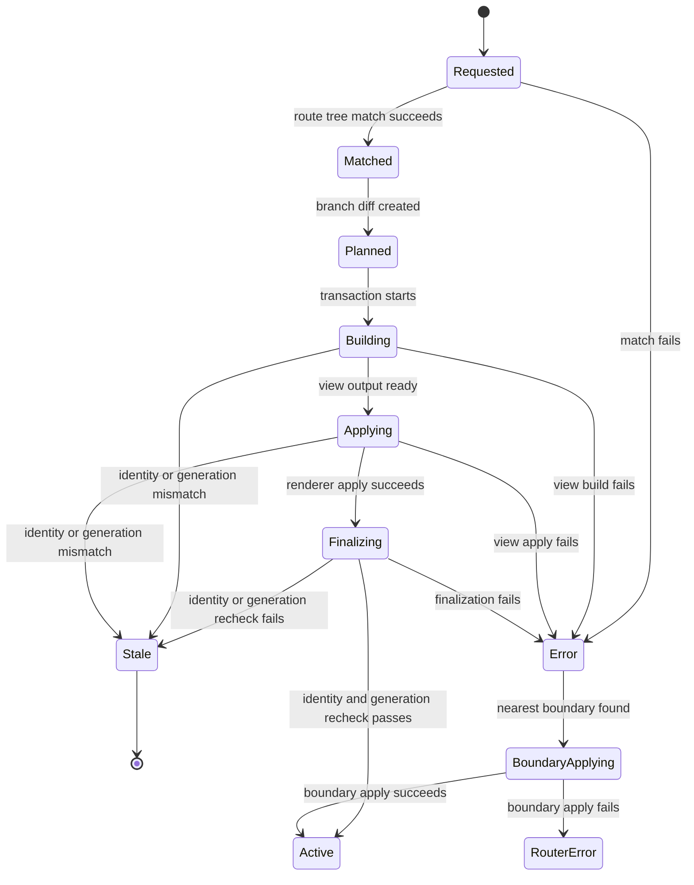

# Bevy UI Router Implementation Readiness Brief

**日期:** 2026-07-07
**状态:** 已通过多方向审查；整体评估不需要整理型重写
**范围:** Phase 0 详细计划启动前的输入整理；不授权代码实现。
**关联执行流:** `docs/superpowers/plans/2026-07-07-phase-0-3-execution-flow.md`

---

## 1. 文档定位

本文把已通过审查的架构路线收敛为实现启动前的工作输入。它不是 Phase 0 的详细实现计划，也不是最终 public API 规格。它只回答一个问题：在编写 Phase 0 详细计划前，哪些合同、边界、草案和验证入口必须先摆到同一张桌面上。

执行边界：

- 本文不新增超出主规划的功能范围。
- 本文不把 Phase 1-3 的实现细节前移到 Phase 0。
- 本文不修改已确认的 crate 边界、MVP 非目标或 adapter 权限。
- Phase 0 详细计划必须引用本文，并把本文列出的冻结项转化为可测试任务。

当前仓库事实：

- 当前仓库仍是单 crate package，根 `Cargo.toml` 直接依赖自定义 Bevy 0.19 git 分支。
- 当前 `src/main.rs` 只是占位程序。
- 目标结构是 multi-crate Cargo workspace，Phase 0 的第一类任务是迁移当前骨架，而不是在现有单 crate 中继续堆叠 Router 语义。

---

## 2. 权威输入

Phase 0 详细计划编写前必须读取：

- `AGENTS.md`
- `docs/superpowers/specs/2026-07-07-project-decisions-design.md`
- `docs/superpowers/specs/2026-07-07-project-architecture-roadmap-plan.md`
- `docs/superpowers/specs/2026-07-07-project-architecture-roadmap-review-log.md`
- `docs/superpowers/plans/2026-07-07-phase-0-3-execution-flow.md`
- `docs/01-BSN-scene-authoring-boundaries.md`
- `docs/02-Web-router-patterns-for-Bevy.md`
- `docs/03-Core-architecture-and-MVP.md`
- `docs/04-Risks-tests-and-handoff.md`
- `docs/05-Non-MVP-capabilities-in-Bevy.md`

读取目标：

- 确认 core 不依赖 Bevy、BSN、platform crate 或 app profile。
- 确认 pending、matched branch 和 partial applied scene 都不是 active UI。
- 确认 adapter 只能通过公开 API 报告 view build/apply 结果。
- 确认 app-owned host 与 router-owned subtree 的 ownership 边界。
- 确认 Phase 0-3 的执行拆分和 gate evidence model。

---

## 3. Phase 0 Public API Draft Scope

Phase 0 只冻结 public API 的最小可执行边界。具体函数签名可以在 Phase 0 详细计划中按 TDD 任务落地，但不得越过下列归属。

### 3.1 Core API 范围

`bevy_ui_router_core` 在 Phase 0 可以公开：

- `RouteLocation` raw boundary。
- `RouterInstanceId`。
- `RouteId`、`RouteSlotId`、`RouteFrameId` 和 `RouteGeneration` 的受控类型。
- memory history 的 `push`、`replace`、`back` 行为。
- requested、matched、active 三类状态分离所需的最小状态容器或诊断结构。
- diagnostics snapshot 的最低身份链。
- error taxonomy 的基础枚举或分类结构。

`bevy_ui_router_core` 在 Phase 0 不公开：

- Bevy `Entity`、component、schedule 或 world 类型。
- BSN scene、BSN macro、scene apply 结果。
- app-specific profile、权限、主题、文案、数据服务或业务 payload 的固定类型。
- typed route/search public API。
- route matcher 与 branch diff 的完整用户 API。

### 3.2 Facade API 范围

`bevy_ui_router` 在 Phase 0 作为 facade crate 建立 re-export 路径：

- default baseline: core + view public contract，不拉入 Bevy。
- `ecs`: 显式启用 ECS integration re-export。
- `bsn`: 显式启用 immediate BSN adapter，并要求或隐含 `ecs`。
- `platform`: 显式启用 router-neutral platform helper。

Phase 0 必须冻结 feature 名称和默认组合。若要推翻 default 不拉入 Bevy 的基线，必须在 Phase 0 计划和变更中记录理由、影响和验证命令。

### 3.3 View API 范围

`bevy_ui_router_view` 在 Phase 0 可以建立 crate 与 public contract 占位：

- renderer-agnostic view descriptor 或 binding key 的命名空间。
- fake/test renderer 的归属策略。
- view build failure 与 apply failure 的报告方向。

Phase 0 不要求 fake renderer 行为完整落地；Phase 3A 实现 view contract 的成功、失败、cleanup、stale result 和 plan provenance 测试。active commit ordering 由 Phase 3B 的 ECS finalization 与 core commit integration 测试证明。

### 3.4 Public Type Ownership 冻结项

Phase 0 必须冻结以下归属：

| 类型或概念 | Phase 0 归属 |
| --- | --- |
| `RouteLocation` | core |
| raw location history | core |
| router、route、slot、frame、generation id | core |
| diagnostics snapshot 基础类型 | core |
| view descriptor 或 view binding key | view，core 只能保存 renderer-neutral key |
| `RouteHost`、`RouteSlot`、frame root marker | ecs |
| BSN scene binding | bsn |
| `BackIntent`、`BackPolicy`、`BackCapabilitySnapshot` | core，platform crate 只生产或读取 |
| app profile | core 外部 |

---

## 4. State Machine Diagram Scope For Phase 0-2

Phase 0-2 的状态机工作分三层推进：Phase 0 先冻结术语和身份字段，Phase 1 产生 matched branch 与 branch diff，Phase 2 建立 runtime frame transaction 与错误路径。



### 4.1 Phase 0 状态机输入

Phase 0 需要冻结：

- requested location 不等于 active UI。
- matched branch 不等于 active UI。
- active rendered branch 只能由已完成 apply、finalization 和身份校验的结果提交。
- 每个 frame 身份至少能关联 router、host、slot、frame identity、generation 和 route id。
- stale check 需要比较 router、host、slot、frame、generation，并为 task/load/apply token 预留字段。

### 4.2 Phase 1 状态机输入

Phase 1 需要把 `Requested -> Matched -> Planned` 变成可测试合同：

- route tree builder 产生稳定 declaration order。
- matcher 输出 `MatchedBranch`。
- params/search fingerprint 参与 branch diff。
- common-prefix frame retention 只影响 router-owned branch suffix。

### 4.3 Phase 2 状态机输入

Phase 2 需要把 `Planned -> Building -> Applying -> Finalizing -> Active` 变成 transaction 合同：

- transaction 记录新建或复用的 frame identities。
- pre-apply stale gate 在写入 World 或等价可见状态前验证 router、host、slot、frame、generation 和相关 token。
- pre-commit identity/generation recheck 在 active commit 前再次验证 router、host、slot、frame 和 generation。
- old active branch 在新 branch 或 error boundary 成功 commit 前保持可回退。
- failed transaction cleanup 只清理本 transaction 创建的 router-owned partial output。

---

## 5. Error Taxonomy Finalization Target

Phase 0 需要冻结 router-neutral 错误分类的命名方向和归属，Phase 2 再补齐 transaction、boundary 和 fake apply-result 行为。这里的名称是工作候选；Phase 0 详细计划可以选择等价的中性名称，但 core error enum 不得固化 Bevy、ECS、BSN、platform package 或 app profile 名称。

| Error kind | 最早冻结阶段 | Phase 0 目标 | 行为落地阶段 |
| --- | --- | --- | --- |
| `NotFound` | Phase 0 | 确认 matcher 失败来源 | Phase 1 |
| `MatchConflict` | Phase 0 | 确认声明或匹配冲突来源 | Phase 1 |
| `GuardRejected` | Phase 0 | 作为 reserved error kind；同步 guard 是否实现由 Phase 0 决定 | Phase 4 或 Phase 0 明确选择的同步子集 |
| `ViewBuildFailed` | Phase 0 | 确认 view build failure 分类 | Phase 2/3A |
| `ViewApplyFailed` | Phase 0 | 确认 view apply failure 分类 | Phase 2/3A/3C |
| `StaleResult` | Phase 0 | 确认 stale 是丢弃路径，不是成功状态 | Phase 2 |
| `AdapterFailed` | Phase 0 | 确认 adapter 失败不能伪装为 core 成功 | Phase 3A/3C |
| `HostOrSlotUnavailable` | Phase 0 | 确认缺失 host/slot 不补建 app-owned host | Phase 2/3B |
| `FinalizeFailed` | Phase 0 | 确认 host/renderer finalization 失败阻止 active commit | Phase 3B |
| `CleanupFailed` | Phase 0 | 确认 cleanup 失败通过明确错误通道表达 | Phase 2/3B |
| `Internal` | Phase 0 | 确认兜底错误不得吞掉来源身份 | Phase 2 |

错误记录最低字段：

- error kind。
- router instance。
- requested location。
- route id，若已知。
- host identity，若已进入 host/slot 阶段。
- slot identity，若已进入 slot 阶段。
- frame id 与 generation，若已分配。
- source category: router core、renderer contract、host/slot integration、input/location integration 或 app extension。
- adapter-provided redacted source label，例如具体 renderer 或 integration 名称；该 label 只进入 diagnostics，不作为 core 固定枚举分支。
- redacted message 或 diagnostics label。

---

## 6. Adapter Responsibility Table Scope

Phase 0 需要冻结 adapter 权限边界，Phase 3A-3D 再实现具体路径。

| 层 | 可以做 | 不能做 | 主要验证阶段 |
| --- | --- | --- | --- |
| core | match、history、branch diff、frame identity、generation、transaction、diagnostics | 依赖 Bevy、BSN、platform API 或 app profile | Phase 0-2 |
| view | 定义 renderer-neutral view descriptor、apply request/result、fake/test renderer | 拥有 route matching、history 或 lifecycle authority | Phase 3A |
| ecs | 在 Bevy World 中创建 host 下的 router-owned frame root，执行 cleanup、visibility、pickability、focus finalization | 销毁或替换 app-owned host，绕过 core commit rule | Phase 3B |
| bsn | 将 code-driven BSN route view 转换并 apply 到 ECS 提供的目标，报告 resolve/apply failure | 持有 history、matcher、frame lifecycle、cleanup authority 或 platform policy | Phase 3C |
| platform | 把系统返回、deep link 或窗口输入翻译为 core intent/location | 直接切换 active frame 或携带业务权限策略 | Phase 4 以后 |
| app integration profile | 组合主题、文案、权限、数据服务和业务错误 payload | 进入 generic core 默认字段 | core 外部 |

Phase 0 详细计划必须把 compile-time boundary 和 dependency boundary 写成可执行检查，至少证明 core crate 不依赖 Bevy、BSN 或 app-specific 概念。

Partial output cleanup handoff 必须保持单向：BSN adapter 或其他 renderer adapter 只能通过公开 view/ECS result 返回 partial output handles、failure 和 disposal hints；真正 cleanup 由 Router/ECS cleanup API 在 identity、stale 和 ownership gate 下执行。adapter 不能直接拥有 cleanup authority。

Back intent 相关类型的归属也必须保持中性：core 拥有 router-neutral `BackIntent`、`BackPolicy` 和 `BackCapabilitySnapshot` 语义；platform crate 只拥有事件翻译、source helper、targeting helper 和 re-export glue，不拥有平台 package policy 或 app exit policy。

---

## 7. Test Harness Outline

测试资产按阶段递进，不在 Phase 0 一次性实现完整矩阵。

### 7.1 Phase 0 测试入口

Phase 0 至少需要：

- `RouteLocation` raw path/search/fragment 构造与诊断展示测试。
- memory history `push`、`replace`、`back` 测试。
- id 与 generation 类型的受控构造测试。
- diagnostics snapshot 包含 router、host、slot、frame、generation 的最低身份链测试。
- dependency boundary check，证明 `bevy_ui_router_core` 不拉入 Bevy。
- route root layout constraint fixture：Phase 0 至少冻结“不允许整 host 重建或触碰 app-owned host”的抽象约束；若具体 ECS layout 测试需要 Bevy component，则在 Phase 3B 落地并由 Phase 0 计划记录后续验证点。
- pending overwrite diagnostics fixture。
- missing host/slot diagnostics fixture。

### 7.2 Phase 1 测试入口

Phase 1 至少需要：

- static、param、catch-all、index、pathless、nested、not-found、conflict matcher fixtures。
- builder declaration order 与 slot key conflict fixtures。
- raw search repeated key、顺序差异、空值、缺失值、percent-encoding normalization fixtures。
- sibling、child、params/search change、layout change、slot change branch diff fixtures。

### 7.3 Phase 2 测试入口

Phase 2 至少需要：

- frame lifecycle fixtures。
- transaction fixtures: pending overwrite、old active retained until commit、failure cleanup scope。
- stale result rejection fixtures。
- nearest error boundary fixtures。
- fake apply-result harness: build success/failure、apply success/failure、partial output。
- adapter identity compile-fail 或等价可见性边界测试。

### 7.4 Phase 3 测试入口

Phase 3A-3D 至少需要：

- fake renderer success/failure/cleanup/stale-result/plan-provenance tests。
- Phase 3B ECS/core handoff、controlled reporter/session、core-owned stale acceptance、active commit ordering tests。
- ECS host/slot missing、route-owned marker、cleanup boundary、focus release、pickability/visibility convergence fixtures。
- BSN adapter resolve/apply error mapping tests。
- neutral minimal nested routes example assertions。

### 7.5 Evidence Requirements

本文完整继承 `docs/superpowers/plans/2026-07-07-phase-0-3-execution-flow.md` 的 §6.2 TDD Evidence Ledger、§6.3 Phase Gate Evidence 和 §6.4 Failed Or Unavailable Verification，不得缩减字段。每个实现任务至少必须记录：

- task id 和 files changed。
- RED 命令、退出码和预期失败摘要。
- GREEN 命令、退出码和通过摘要。
- commit SHA，或明确说明该任务尚未到提交边界的原因。
- 阶段 gate verification 命令、退出码和输出摘要。
- failed、skipped 或 unavailable command 的具体原因，以及该原因是否让 gate 保持 unverified 或 blocked。

如果命令不可用是因为目标 crate 尚不存在，active plan 必须指出哪个任务创建该 crate，以及哪个后续步骤重新运行该命令。

---

## 8. Minimal Examples Outline

Phase 3D 需要一个中性 minimal nested routes example。它不应使用业务领域对象、品牌、主题、权限、数据服务或特定宿主 shell 假设。

推荐 route 结构：

```text
root
  |- index
  |- section
  |  |- index
  |  `- detail/:id
  `- settings
```

示例必须证明：

- 同一 route tree 可以服务 fake/test renderer 路径。
- immediate BSN adapter 路径可以挂载 nested route。
- active branch 与 requested location 分离。
- frame root marker 包含 router、host、slot、frame、generation 和 route identity。
- diagnostics snapshot 包含 active branch、pending/error state 和 adapter path。
- failure path 能映射为 Router error，而不是伪装为成功 active UI。

执行形态由 Phase 3D 计划冻结：

- 可运行 example: `cargo run --example minimal_nested_routes --features bsn`。
- 或 integration test 形态，并在 Phase 3D 计划中记录等价命令。

---

## 9. Open Decisions Phase 0 Must Freeze

以下决策必须在 Phase 0 详细计划或 Phase 0 实施中冻结，不能被 Phase 1-3 隐式决定。

| 决策 | 推荐基线 | 取舍 |
| --- | --- | --- |
| facade default feature | default 不拉入 Bevy | 依赖更小；入门需要显式启用 ECS/BSN |
| feature names | `ecs`、`bsn`、`platform`、`devtools` | 名称简单；Phase 0 要记录 `bsn` 是否隐含 `ecs` |
| core id constructors | 受控构造器或 crate-visible internals | 防止 adapter 伪造身份；测试需要公共观察方式 |
| generation stale invariant | Phase 0 冻结 generation 受控、adapter 不可伪造、复用 frame id 时必须可区分新旧 attempt；Phase 2 冻结具体递增时机 | 避免 Phase 0 过早锁定 transaction 机制；仍保护 stale check 可测试 |
| `GuardRejected` | Phase 0-3 作为 reserved error kind | 保留 error taxonomy；不承诺 pending guard 行为 |
| sync guard | 不进入 Phase 0-3 可执行范围，除非 Phase 0 明确改选最小同步子集 | 范围更稳；若实现同步子集，需要新增 matcher 前后时序测试 |
| raw search fingerprint ownership | Phase 1 冻结具体 canonicalization，Phase 0 冻结默认不读 app payload | 避免过早设计 typed search；Phase 1 必须补足 repeated key 和 encoding 测试 |
| diagnostics payload | 默认 redacted，不包含 app payload | 防止泄漏业务数据；应用可显式提供 label/serializer |
| fake renderer boundary | Phase 0 冻结 fake renderer 不进 core、不依赖 Bevy/BSN、用于合同测试；Phase 3A 冻结具体 crate、feature 和 API visibility | 避免提前锁死 view testing surface；仍保证 core 边界不被污染 |
| compile-fail strategy | Phase 0/2 使用 visibility boundary 或 compile-fail tests 证明 adapter 不能伪造 identity | compile-fail 更强；visibility tests 更轻，Phase 0 要选执行方式 |

---

## 10. Phase 0 Plan Handoff

Phase 0 详细计划必须把本文拆成可执行任务，至少覆盖：

- workspace migration。
- core crate creation。
- facade crate creation。
- core id types。
- raw `RouteLocation`。
- memory history。
- diagnostics baseline。
- dependency boundary tests。
- route root layout constraint fixture 或明确的 Phase 3B 具体化验证点。
- pending overwrite 与 missing host/slot diagnostics fixtures。
- final Phase 0 verification。

Phase 0 计划 acceptance gate 必须确认：

- 本文列出的 Phase 0 冻结项都有对应任务。
- 没有实现 Phase 1 matcher、Phase 2 transaction 或 Phase 3 adapter 的完整行为。
- 所有新增 public surface 都有归属 crate。
- 所有验证命令有明确期望输出和 gate 含义。
- 任何环境限制都被记录为 unverified 或 blocked，而不是通过。

通过本文审查后，下一步只能创建 `docs/superpowers/plans/2026-07-07-phase-0-contract-freeze-implementation-plan.md`。代码实现仍必须等待 Phase 0 详细计划完成、自检、审查 gate 通过，并完成用户确认的执行模式。
